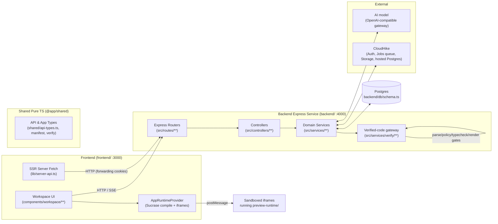
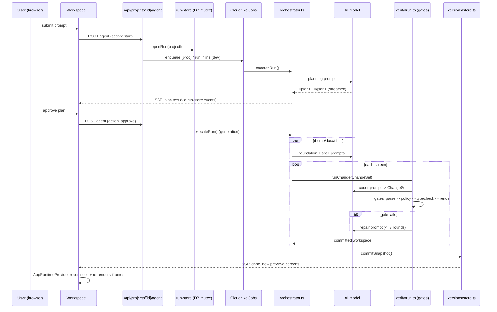
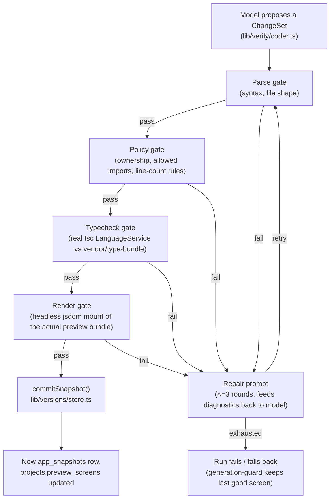
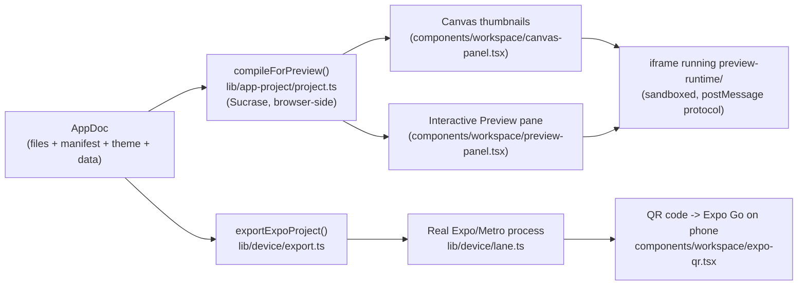
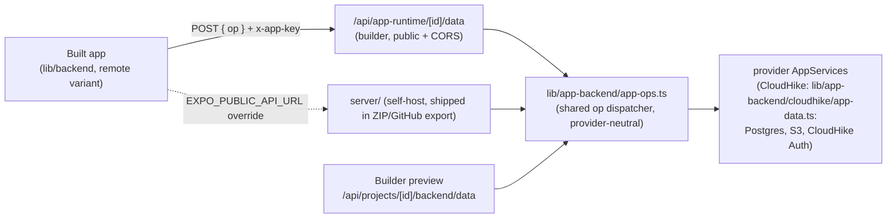
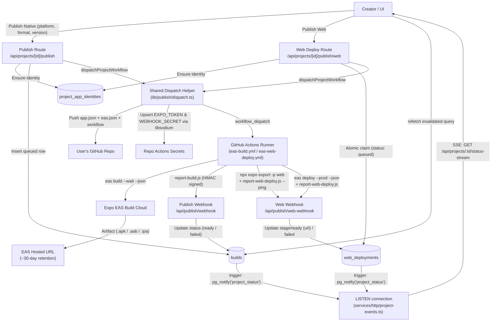

# Architecture

This document describes the system architecture of **Anything** — a Lovable/v0-style
builder that turns a text prompt into a real Expo/React Native mobile app, with live
browser preview, canvas-based visual editing, QR-to-phone preview via Expo Go, a
Code tab with diffs/versions, and an optional "Connect Backend" step that provisions
a real Postgres/Auth/Storage backend via **CloudHike** (the platform this app runs on
and integrates with for auth, job queueing, and storage).

A companion document, [`codebase-walkthrough.md`](./codebase-walkthrough.md), is a
file-by-file, flow-by-flow tour intended for someone who hasn't read this codebase
before. This document instead focuses on the *shape* of the system: the major
subsystems, how they fit together, and the design decisions behind them.

An interactive version of this document (with rendered diagrams) was also published
as a Claude Artifact.

---

## 1. System overview



The core idea: **the AI never writes code directly into the project.** Every change —
whether from a chat message, a plan approval, or a tap-to-edit on the canvas — is
expressed as a `ChangeSet` and pushed through a verification pipeline (parse → policy
→ typecheck → render) with bounded automatic repair before it is committed as a new
version.

The architecture is cleanly separated into three npm workspaces:
- `frontend`: Pure Next.js UI layer (App Router), zero direct DB access. Client components communicate via `apiClient` (`NEXT_PUBLIC_API_URL`), and SSR pages fetch via `lib/server-api.ts`. `frontend/next.config.ts` also rewrites same-origin `/api/*` to the backend (`BACKEND_INTERNAL_URL`), so OAuth callbacks, webhooks, app-files URLs and the ZIP download keep working at the frontend's address.
- `backend`: Standalone Express 5 REST API running on port 4000 with a strict layered structure: `routes` → `controllers` → `services` → `db`.
- `shared`: Pure TypeScript code shared between frontend and backend without Node, React, or database dependencies.

---

## 2. Major subsystems

| Subsystem | Location | Responsibility |
|---|---|---|
| Workspace UI | `frontend/components/workspace/**` | Chat, Canvas, Preview, Code, Changes, Versions panes |
| Client API & Query Layer | `frontend/lib/api-client.ts`, `frontend/components/query-provider.tsx` | React Query + Axios client for all client component data queries and mutations |
| Express API & Routing | `backend/src/routes/**`, `backend/src/controllers/**` | REST endpoints, authentication middleware, request validation, error formatting |
| Agent orchestrator | `backend/src/services/agent/**` | Planning, screen/theme/data generation, run lifecycle, SSE streaming |
| Verified-code gateway | `backend/src/services/verify/**` | `ChangeSet` application, gates, bounded repair, commit |
| App manifest | `shared/manifest/**` | Zod-validated structural model (screens/nav/collections) compiled deterministically into layout/nav/type files |
| Platform kit | `backend/src/services/app-project/kit.ts` | Typed component vocabulary (`@/kit`) the AI is restricted to |
| Motion kit | `backend/src/services/app-project/motion.ts`, `platform-kits.ts` | Animation primitives (`@/motion`) on Reanimated 4 + gesture-handler 3, scaled to a per-app motion level |
| Preview runtime | `frontend/preview-runtime/` + `shared/preview/**` | Sandboxed iframe runtime: file-based router, RN/Expo shims, element inspector |
| Device preview | `backend/src/services/device/**` | Exports a project as a real Expo project, runs a local Metro lane, QR-to-Expo-Go |
| Project Export (ZIP & GitHub) | `backend/src/services/github/**`, `backend/src/services/app-project/zip-export.ts` | Exports runnable Expo project as ZIP or pushes directly to GitHub with real-time SSE progress |
| Backend integration | `backend/src/services/app-backend/**` (neutral core + one folder per provider), `shared/app-backend/providers.ts`, `frontend/lib/backend/**` | Connects a project to a real Postgres/Auth/Storage backend on a pluggable provider (CloudHike today) |
| Platform identity | `backend/src/services/identity/**` | The builder's own sign-in behind an `IdentityProvider` interface (CloudHike Auth today) |
| Versioning | `backend/src/services/versions/**` | Snapshot store, diffing, restore |
| Jobs | `backend/src/services/jobs/**` | `JobQueue` interface (Cloudhike Jobs today); routes agent runs to a worker or runs inline in dev |
| Persistence | `backend/db/**` | Drizzle schema + hand-applied SQL for non-drizzle-managed tables |

---

## 3. Request flow: "build an app from a prompt"



Key properties of this flow:

- **One run per project at a time.** `lib/agent/run-store.ts` enforces this with a
  DB-level partial unique index, not just in-memory state — so it is safe across
  job-queue workers and server restarts.
- **Dev vs. prod dispatch is transparent to the orchestrator.** `agentRunner()` in `lib/jobs/index.ts`
  picks between enqueueing to the job queue (`jobQueue`, Cloudhike Jobs today) and calling `executeRun`
  in-process for local development; `app/api/jobs/agent/route.ts` is the webhook the
  queue worker calls back into.
- **Progress streams over SSE**, backed by an `agent_events` table rather than a raw
  in-memory stream, so a client reconnect (or a page it opens from a second tab)
  can resume mid-run.

---

## 4. The verified-code pipeline



Why this exists: earlier versions of this product let the model write files directly
into the project. That produced apps that looked right in the chat transcript but
crashed in the actual preview (bad imports, type errors, or runtime exceptions in
React Native-specific code the model doesn't reliably know). The verified-code engine
closes that gap by gating every change against the *real* toolchain — a real
TypeScript compiler, and a real mount of the real preview bundle — before it's ever
shown to the user as "done."

Supporting pieces:

- **`lib/manifest/**`** — screens, navigation, and data collections are modeled as a
  Zod-validated manifest, not free-form files. Layout/nav/type files are compiled
  *deterministically* from the manifest (`lib/manifest/compile.ts`), so the AI cannot
  break routing or navigation — it only edits manifest-owned content and screen bodies.
- **`lib/app-project/kit.ts`** (`@/kit`) — a constrained, typed component vocabulary
  (Screen/Stack/Text/Button/Card/etc.) the model is steered toward, instead of raw
  React Native primitives, to reduce the space of mistakes it can make.
- **`lib/app-project/motion.ts`** (`@/motion`) — the motion kit: `Reveal`, `Stagger`,
  `PressableScale`, `AnimatedNumber`, `Skeleton`, `ParallaxScroll`, `SwipeRow`, `Sheet`,
  `SegmentedTabs` and `useMotion()`, built on Reanimated 4 and gesture-handler 3. Its
  springs, distances and timing come from the app's **motion level** (`subtle` /
  `expressive` / `bold`), which the foundation step picks into `ThemePackage.motion`
  and `platformFiles` writes to `motion/level.ts`; everything honours the system
  reduce-motion setting. `@/kit`'s `Button`, `Card` and `ProgressBar` are built on it.
  `lib/app-project/platform-kits.ts` is the one place both kits are added to a build
  and resynced into older projects on every edit (`platformKitUpdates`).
- **Reanimated in the preview** — device builds get the worklets Babel plugin from
  `babel-preset-expo` automatically; the preview compiles with Sucrase instead, where
  Reanimated only subscribes to the shared values listed in a hook's dependency array.
  So the policy gate rejects `useAnimatedStyle` / `useDerivedValue` /
  `useAnimatedProps` / `useAnimatedReaction` calls without one (`reanimated_deps`):
  otherwise the animation would freeze silently in the preview, past every other gate.
- **`lib/verify/router.ts`** — a fast classifier that skips full planning for small
  edits (e.g. "make the button blue"), routing straight to a targeted `ChangeSet`.
- **`lib/verify/codemod.ts`** — canvas tap-to-edit applies AST-level codemods with
  *no model call at all*, then still runs through the same gates.
- **Phase status**: this is the only pipeline in the app as of 2026-11-18 (the legacy
  non-verified engine was fully removed, not just flagged off). See
  [`verified-code-plan.md`](./verified-code-plan.md) and
  [`verified-code-pending.md`](./verified-code-pending.md) for the phase-by-phase plan
  and open items (hosted/no-Wi-Fi device preview is the only not-started phase).

---

## 5. Preview system: three ways to see the app



1. **Canvas / in-browser preview** — every project file is compiled client-side with
   Sucrase and loaded into sandboxed `<iframe sandbox="allow-scripts allow-forms">`
   elements via a `postMessage` protocol (`lib/preview/protocol.ts`). The iframe side
   runs `preview-runtime/`, a single bundled file (`public/preview/runtime.js`, built
   by `scripts/build-preview.mjs`) that includes an Expo-Router-like file-based router,
   React Native/Expo API shims, the real web builds of `react-native-reanimated`,
   `react-native-worklets` and `react-native-gesture-handler` (resolved with `.web.js`
   first and `react-native` aliased to `react-native-web`), and a dev JSX factory that
   stamps every element with a `data-eid` for the inspector and codemod targeting.
2. **Render gate** — the *same* preview bundle is mounted headless in jsdom as part of
   the verified-code pipeline (§4), so "does it render" is checked with the real
   runtime, not a mock.
3. **Real device preview** — `lib/device/export.ts` writes the project out as an actual
   Expo project; `lib/device/lane.ts` manages a local Metro process per project; the
   user scans a QR code with Expo Go to see the app on a real phone. A hosted
   (no-shared-Wi-Fi) variant is planned but not yet built — see §4.

   *Note*: `lib/app-project/scaffold.ts` is the shared source for `babel.config.js`,
   `metro.config.js`, and `.gitignore`, consumed by both the local device preview lane
   and the standalone project exports (ZIP download and GitHub push).

---

## 6. Backend integration ("Connect Backend")

```mermaid
flowchart LR
    UI["backend-connect.tsx\n(providers from shared/app-backend/providers.ts)"] --> Routes["/api/backend-providers/:provider/*\n(connect + callback)"]
    Routes --> Registry["lib/app-backend/registry.ts\n(getProvider / providerFor)"]
    Registry --> Adapter["lib/app-backend/cloudhike/\n(BackendProvider adapter)"]
    Adapter --> Prov["provision: \"backend engineer\" agent\non CloudHike MCP"]
    Prov --> CH["CloudHike platform\n(real Postgres / Auth / Storage project)"]
    CH --> Row["lib/app-backend/app-backend.ts\n(app_backends row: provider, encrypted env)"]
    Row --> Generated["Generated app code calls\nlib/backend (AppBackend interface)"]
```

Generated apps never call a provider directly. They call a small `AppBackend`
interface (`lib/backend/types.ts`) with implementations for local/in-device storage
(`local-backend.ts`) and a connected provider reached through our server (`server-backend.ts`),
selected by `createBackend()` (`lib/backend/index.ts`). This keeps generated app code
backend-agnostic and makes "preview without a backend" vs. "connected to a real
backend" a configuration switch rather than two codepaths.

Provisioning is the provider's job. For CloudHike, `lib/app-backend/cloudhike/provision.ts` runs a
"backend engineer" AI loop that calls CloudHike's MCP tools (create project, deploy services) in a
tagged-reply protocol similar to the main orchestrator's.

**Built apps (APK, Expo Go preview, web deploy, ZIP/GitHub export) use the same backend.**
The stored project files always carry the on-device `lib/backend` (local storage). At output
time `lib/app-project/with-backend.ts` checks whether the project's backend is ready
and, if so, swaps in `lib/app-project/backend-remote.ts`'s version (same hooks, HTTP calls) plus a
`lib/backend/config.ts` holding the endpoint and a per-project public app key. The swap is applied
to the output, not stored, because the stored files are regenerated on every plan change and a
disconnect must be able to revoke the key. A device bundle can't hold database credentials, so
those calls go to a server that does:



`app-ops.ts`, `contract.ts`, the provider's data plane (CloudHike: `cloudhike/app-data.ts`) and
`shared/app-runtime/data-model-types.ts` have no builder-only imports on purpose: the provider's
`selfHost()` (CloudHike: `cloudhike/self-host.ts`) copies them verbatim into a ZIP/GitHub export's `server/`,
so the self-hosted server runs the exact logic the preview does. Credentials stay encrypted in
`app_backends.env_enc` on the builder, or in the user's own `server/.env` when self-hosted.

### Pluggable providers

Every external service the platform depends on sits behind an interface with one adapter today,
so moving to another vendor (or our own system) means a new adapter, not edits across callers:

| Seam | Interface | Picked in | Today |
|---|---|---|---|
| Builder sign-in | `IdentityProvider` (`lib/identity/types.ts`): `signUp`, `signIn`, `getSessionUser`, `signOut` | `lib/identity/index.ts` (`identity`) | CloudHike Auth (`identity/cloudhike.ts`) |
| Agent job queue | `JobQueue` (`lib/jobs/queue.ts`): `enqueue`, `get`, `verifySignature` | `lib/jobs/index.ts` (`jobQueue`) | Cloudhike Jobs (`jobs/cloudhike-jobs.ts`) |
| Creators' app backends | `BackendProvider` (`lib/app-backend/types.ts`): `connect`, `provision`, `syncSchema`, `runtime` → `AppServices`, `readFile`, `selfHost` | `lib/app-backend/registry.ts`, per app via `app_backends.provider` | CloudHike (`app-backend/cloudhike/`) |

Notes on each:

- **Identity.** `users.id` is the identity provider's user id and the `ch_session` cookie holds its
  token, so a replacement must keep existing ids (or ship a migration mapping them). Hosted social
  sign-in is configured by `NEXT_PUBLIC_AUTH_URL` on the frontend.
- **Job queue.** Without a configured queue (or with `AGENT_RUNNER=inline`) runs execute in-process.
- **App backends.** Several can coexist: each app's `app_backends.provider` names its adapter, and the
  op protocol (`app-ops.ts`) only ever sees `AppServices` (`contract.ts`), so generated app code and
  exports never change per provider.

**Adding a backend provider (e.g. Supabase):**
1. Add an entry to `BACKEND_PROVIDERS` in `shared/app-backend/providers.ts` (label, tagline, dashboard
   URL, billing note, offered/required services). The Connect dialog renders it from there.
2. Add `backend/src/services/app-backend/<id>/` with an `index.ts` exporting a `BackendProvider`:
   account link (authorize URL + code exchange; its callback is `/api/backend-providers/<id>/callback`),
   provisioning (save the row with `saveBackend(projectId, "<id>", …)` and `setDocBackend`),
   `runtime()` implementing `AppServices`, `readFile`, `syncSchema` and `selfHost()`.
3. Add one line to `PROVIDERS` in `lib/app-backend/registry.ts` (the registry test fails until
   every catalogue entry has an adapter).

---

## 7. Project Export (Download as ZIP + Push to GitHub)

The workspace allows creators to export the complete generated Expo project outside Anything:

1. **Download as ZIP** (`lib/app-project/zip-export.ts`, `/api/projects/[projectId]/export/zip`):
   - Merges workspace files (`workspaceFromDoc`), generic scaffold files (`scaffoldFiles(null)`: `babel.config.js`, generic `metro.config.js`, `.gitignore`), and a generated `README.md` (`readmeFile(projectName)`).
   - If the project's backend is connected, `lib/backend` is the remote variant (above), and the export also gets the provider's self-host files: `server/`, `server/.env.example`, `.env.example` and a README section with step-by-step instructions (keep using the hosted backend, or run your own server and deploy it). GitHub push exports the same file set.
   - Bundles files into an in-memory ZIP buffer with JSZip (DEFLATE compression) and streams with `content-disposition: attachment; filename="<slug>.zip"`.
   - Client triggers download via Axios blob mutation and hidden anchor tag.

2. **Push to GitHub** (`lib/github/**`, `components/workspace/github-push-dialog.tsx`):
   - **OAuth Connect** (`/api/github/connect`, `/api/github/callback`):
     - Pinned with signed HMAC state cookie (`gh_connect`), requests `repo` scope.
     - Tokens encrypted at rest using AES-256-GCM (`lib/crypto/secret-box.ts`) with `SECRETS_ENCRYPTION_KEY` (the old name `CLOUDHIKE_ENCRYPTION_KEY` is still read).
     - Stored in `github_connections` table (`userId`, `accessTokenEnc`, `githubLogin`, `githubUserId`, `scope`, `status`).
   - **Repository Link Tracking**:
     - `project_github_links` table records the linked repository (`repoOwner`, `repoName`, `lastBranch`, `lastCommitSha`) per project.
   - **Full-Tree-Overwrite Push Algorithm** (`lib/github/push.ts`):
     - Step 1 (`resolving-repo`): creates a new repo or verifies an existing target repo.
     - Step 2 (`reading-branch`): checks ref for target branch or base branch (404 implies empty repo, no parent).
     - Step 3 (`building-tree`): calls GitHub Git Data API `POST /repos/.../git/trees` with inline blob contents for all files without passing `base_tree`, guaranteeing files deleted by AI are removed from the commit.
     - Step 4 (`committing`): calls `POST /repos/.../git/commits` referencing the tree and parent commit (if existing).
     - Step 5 (`updating-branch`): updates branch ref with `PATCH /repos/.../git/refs/...` (fast-forward) or creates ref with `POST /repos/.../git/refs` (new branch or first commit).
   - **Real-Time Step Progress**:
     - Push route (`/api/projects/[projectId]/github/push`) streams Server-Sent Events (`text/event-stream`, using generic helper `lib/http/sse.ts`) reporting step transitions (`resolving-repo` → `reading-branch` → `building-tree` → `committing` → `updating-branch`) and final done/error payloads.
     - UI displays real-time step checkmarks and spinners.

---

## 8. Publish / EAS builds & Web Hosting

The Publish subsystem enables users to export their generated Expo apps either as native installable packages (`.apk` / `.aab` for Android, `.ipa` for iOS) or as live websites via Expo EAS Hosting. Because this platform is hosted serverlessly (e.g. Vercel) and cannot run native mobile compilation or heavy export jobs itself, the architecture pushes the compute cost onto infrastructure the user already owns: their own connected GitHub repository (GitHub Actions compute) and their own Expo / EAS account (cloud build workers and hosting).



Build, web-deploy and device-build status is **pushed, not polled**. `db/sql/status-notify.sql`
installs `AFTER INSERT OR UPDATE` triggers on `builds`, `web_deployments`, `web_deploy_runs`
and `device_builds` that `pg_notify` the table and project id (never row data). One backend
`LISTEN` connection fans these out to open `status-stream` SSE connections; the browser then
invalidates the matching React Query key and refetches through the normal authenticated GET.
`LISTEN` needs a session-pinned connection, so the listener uses `DIRECT_URL` (a
transaction-mode pooler drops it). When the listener reconnects it sends a `resync` event,
because notifications sent while it was down are lost.

### Key Architectural Components

1. **GitHub-Actions-in-User's-Repo Compute & Shared Dispatcher**:
   - `dispatchProjectWorkflow()` in `lib/publish/dispatch.ts` unifies pushing workflow files and code, upserting repository secrets, and dispatching GitHub Actions runs with automatic workflow run correlation.
   - For native builds: commits `eas.json`, `.github/workflows/eas-build.yml`, and `.github/scripts/report-build.js` along with version-patched `app.json`.
   - For web hosting: commits `eas.json`, `.github/workflows/eas-web-deploy.yml`, and `.github/scripts/report-web-deploy.js` with identity-patched `app.json` (no version bump). Runs `npx expo export -p web` followed by `eas deploy --prod --json`.
   - Workflows run with `continue-on-error: true` and `if: always()` report scripts to ensure terminal outcomes are always reported back.

2. **Sealed-Box Secret Delivery**:
   - Repository Actions secrets (`EXPO_TOKEN` and `PUBLISH_WEBHOOK_SECRET`) are encrypted in-memory using libsodium's `crypto_box_seal` with the repository's Actions public key (`GET /repos/{owner}/{repo}/actions/secrets/public-key`), then uploaded idempotently via `PUT /repos/{owner}/{repo}/actions/secrets/{name}`.

3. **Database Schema & Current-State Web Deployments**:
   - `builds`: Append-only build records for native packages. Retrying a build inserts a new record rather than mutating the old one. A partial unique index `builds_one_active_per_target` on `(projectId, platform, format) WHERE status in ('queued', 'dispatching', 'building')` provides database-level enforcement against concurrent duplicate builds.
   - `web_deployments`: Current-state row per project (`projectId` primary key). Tracks current status (`queued` → `dispatching` → `building` → `deploying` → `ready` / `failed`), workflow correlation info, and live production `url`. Rerunning `eas deploy --prod` updates the existing site in place; the `url` is preserved across republishes.
   - `project_app_identities`: Stores immutable package name (`androidPackage`) and bundle identifier (`iosBundleId`) seeded from initial `app.json`, plus EAS metadata (`easProjectId`, `expoOwner`) populated lazily.
   - `expo_connections`: Stores user's Expo Personal Access Token, encrypted at rest using AES-GCM via `lib/crypto/secret-box.ts`.

4. **Webhook Trust Boundary & HMAC Verification**:
   - The webhook routes (`/api/publish/webhook` and `/api/publish/web-webhook`) have no user session; their trust boundary is strictly authenticated via a Stripe-style HMAC-SHA256 signature in the `x-publish-signature: t=<timestamp>,v1=<hex>` header.
   - Report scripts compute HMAC-SHA256 over `${timestamp}.${rawBody}` using `PUBLISH_WEBHOOK_SECRET`.
   - Web deploy reports include a mid-workflow ping (`stage: "deploying"`) when export succeeds and `eas deploy` begins, allowing the UI to present accurate progress stages.
   - Status updates are idempotent: payloads received for builds or web deployments already in a terminal state (`ready` or `failed`) return 200 immediately.

5. **Credentials Failure Detection**:
   - EAS error logs are inspected in the report script for missing Apple Developer signing credentials (distribution certificate / provisioning profile). If detected, `needsIosCredentials` is set to 1, prompting the UI to display dedicated Apple credentials setup instructions.

---

## 9. Persistence

- **Drizzle-managed**: `agent_runs` / `agent_events` (run mutex + SSE log),
  `app_snapshots` (version history), `cloudhike_connections` / `app_backends`
  (backend-connect feature, secrets encrypted via `lib/crypto/secret-box.ts`),
  `github_connections` / `project_github_links` (GitHub export tokens and repository links),
  `builds` / `project_app_identities` / `expo_connections` / `web_deployments` (Publish / EAS builds and web hosting subsystem,
  including partial unique index `builds_one_active_per_target`, live web deployment status, and encrypted Expo credentials).
- **Hand-applied SQL** (`db/sql/*.sql`, applied via `npm run db:sql` →
  `scripts/migrate-sql.mjs`, all idempotent; includes `status-notify.sql`, the NOTIFY triggers for status SSE): `users`, `projects` (holds `prompt`,
  `preview_screens` as the whole `AppDoc` JSON, `current_version`, `assets`),
  `messages` (chat history + plan/pipeline data), `image_library` (curated seed image
  library with generated `tsvector` column and GIN index for full-text search),
  and `image_library_misses` (gap tracker for unmatched image queries with upsert
  hit counter), `cloudhike.sql`, and `github.sql` (schema definitions for GitHub connections
  and project links).

---

## 10. Build & eval tooling

- **`scripts/build-preview.mjs`** — esbuild-bundles `preview-runtime/` into
  `public/preview/runtime.js`; runs automatically before `dev`/`build`.
- **`scripts/seed-image-library.ts`** (`npm run seed:images`) — bulk imports a manifest
  of curated photos into ImageKit (`/appforge/library/<category>`) and Postgres
  `image_library`, idempotent on re-runs.
- **`scripts/device-preview.ts`** / **`lib/device/**`** — local Metro lane CLI for
  real-device preview.
- **`scripts/eval.ts`** + **`eval/**`** — evaluation harness that runs the agent
  against fixed project fixtures and measures first-pass vs. verified-and-committed
  success rate and time-to-verified (current baseline on the `notes` fixture: 42%
  first-pass, 77% verified-and-committed, p50 21.1s).
- **`vendor/type-bundle/`** — a pinned, isolated `node_modules` install the real `tsc`
  gate type-checks generated code against, independent of this app's own dependencies.
- **`scripts/migrate-to-verified.ts`** — one-off script used to migrate all existing
  projects onto the manifest/verified engine when the legacy engine was removed.

---

## 11. Design decisions worth knowing

- **The AI is never trusted to be correct; it's trusted to be checkable.** Every
  mechanism above (manifest compilation, the `@/kit` vocabulary, the gate pipeline,
  bounded repair) exists to narrow what the model can break and to catch it
  deterministically when it does, rather than relying on prompt quality alone.
- **Preview and "the real app" are the same code path.** There is no separate "demo
  renderer" — the browser preview, the render gate, and (via export) the real Expo/
  Metro build all run the same project files and the same `preview-runtime/` bundle
  family. This is what makes the render gate meaningful.
- **Structure vs. content split.** The manifest/compile step owns anything that, if
  broken, would break the whole app (navigation, routing, data types). The AI only
  ever touches screen bodies and manifest *entries*, never the compiled output.
