# Codebase Walkthrough (Feature by Feature)

This doc exists so you can explain *how a feature works* to someone else — not just
"where the files are." Each section below covers one user-facing feature: what it
does, a diagram of the flow, a plain-English step-by-step, and (for when you want to
go deeper) the exact files involved and their roles. Read
[`architecture.md`](./architecture.md) first for the big-picture subsystem map; this
doc is the "zoom in on each piece, in plain language" version.

An interactive version with the same structure (diagrams, step-by-step, collapsible
file lists per feature) was also published as a Claude Artifact.

---

## 1. Creating a project from a prompt

**What it does**: user types a prompt (+ optional reference images) on the homepage,
hits submit, and lands in a new workspace with that prompt as the first chat message.

**The flow**:

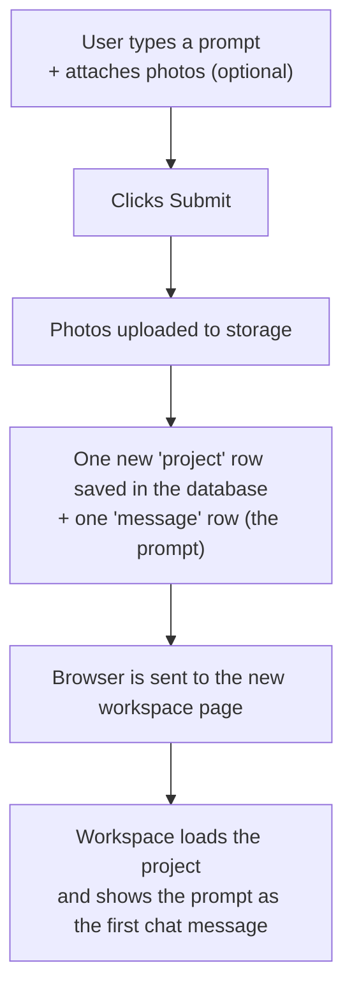

**Step by step, in plain English**:

1. You type what app you want, and optionally attach reference images.
2. Clicking Submit uploads any images first.
3. The server creates a new project record and saves your prompt as the first chat message — in one go, so you never end up with a project and no message, or vice versa.
4. Your browser is redirected to that project's workspace page.
5. The workspace loads up and shows your prompt waiting in the chat — but the AI hasn't actually started building anything yet (that happens next, see §2).

**Files involved**:

| File | Role |
|---|---|
| `app/page.tsx` | Homepage; renders `PromptBox` |
| `components/home/*` (prompt box, examples) | The input UI, asset attach, submit |
| `app/api/projects/route.ts` | HTTP route handler for listing and creating user projects |
| `lib/projects/create-project.ts` | Business logic: validates input, uploads assets to storage, handles rollback on error |
| `db/projects.ts` | Database queries and transactions for projects and initial message records |
| `lib/storage.ts` | S3-compatible upload helper for attached assets |
| `db/schema.ts` | `projects`, `messages` table shapes |
| `app/workspace/[projectId]/page.tsx` | Server component the browser lands on next: loads the project + message history + backend status, renders `WorkspaceShell` |

**How to explain it to someone technical**: "Submitting the homepage prompt is just
an insert, not an agent run — it creates the project row and a 'user' message, then
redirects into the workspace. The actual AI work (planning, generating screens) only
starts once the workspace page's `useAgent` hook fires its first request to the
agent endpoint."

---

## 2. The agent conversation (chat -> plan -> generate)

**What it does**: this is the core loop. The user chats with an AI that either
answers, proposes a plan (for a first build or a big structural change), or makes a
small edit directly. Progress streams into the chat panel live.

**The flow**:

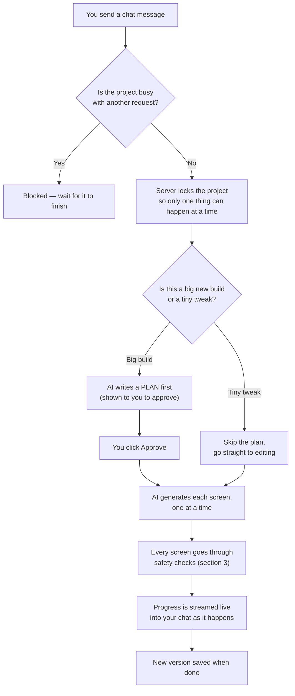

**Step by step, in plain English**:

1. You send a message in the chat.
2. The server checks: is this project already busy doing something else? If so, your request waits.
3. If it's free, the server "locks" the project — this guarantees only one AI job ever runs on a project at a time, even if you click twice.
4. The AI first decides: is this a brand-new build or a big change (needs a plan you approve first), or just a small tweak (goes straight to editing)?
5. For a new build: the AI writes a short plan, shows it to you, and waits for you to click Approve before writing any code.
6. Once approved (or for small edits), the AI generates the actual screens one at a time.
7. Every single screen it writes passes through the verification pipeline (§3) before it's considered "done".
8. The whole time, you see live progress text streaming into the chat — you're not just staring at a spinner.

**Files involved**:

| File | Role |
|---|---|
| `components/workspace/use-agent.ts` | Client hook: owns the SSE connection, local run state, sends chat/approve/resume actions |
| `components/workspace/chat-panel.tsx` | Chat UI: message list, plan-approval UI, input box |
| `app/api/projects/[projectId]/agent/route.ts` | Entry point. Picks a `task` ("plan" / "generate" / "backend") based on project state, opens a run, dispatches it, streams the SSE response back |
| `lib/agent/run-store.ts` | DB-backed mutex (`openRun`) so only **one run per project** can be active at a time, enforced by a Postgres partial unique index — plus the event sink that backs the SSE stream (`agent_runs` / `agent_events` tables) |
| `lib/jobs/cloudhike-jobs.ts` | Decides whether to enqueue the run to the Cloudhike Jobs HTTP queue (production) or just call `executeRun` in-process (local dev) |
| `app/api/jobs/agent/route.ts` | The webhook a Cloudhike Jobs worker calls back into to actually execute a run in production |
| `lib/agent/execute.ts` | `executeRun` — the single entry point both paths above call into |
| `lib/agent/orchestrator.ts` | The brain. Facade re-exporting modular agent lifecycle subsystems: planning (`planning.ts`), generation (`generation.ts`), message routing (`router.ts`), history & state persistence (`history.ts`), repair (`repair.ts`), canvas AST edits (`canvas-edit.ts`), and verified single-screen edits (`verified-edit.ts`) |
| `lib/agent/protocol.ts` | Parses the planner's tagged-block replies into structured data |
| `lib/agent/config.ts` | Picks which model to use (`getModel` / `getFastModel` / `getCoderModel`) and reasoning effort per task |
| `lib/verify/router.ts` | Fast classifier run *before* full planning — if a message is a small edit ("make the button blue"), skips straight to a targeted change instead of a full plan |

**How to explain it to someone technical**: "There's exactly one AI-facing entry
point (`/api/projects/[id]/agent`), and it's a dumb dispatcher — all the actual
decision-making (is this a new build? a small edit? a backend request?) happens in
the orchestrator. The run-store's DB mutex is what stops two requests (e.g. a flaky
double-click) from running the agent twice on the same project at once. Everything
streams over Server-Sent Events backed by a real DB table, not an in-memory stream —
so if you refresh the workspace mid-run, it can reconnect and pick up where it left
off instead of losing the run."

---

## 3. The verified-code pipeline (why generated code doesn't crash)

**What it does**: whenever the AI needs to actually write or change a screen's code
— during generation, during a chat-driven edit, or during repair — it doesn't just
hand back text that gets saved. It proposes a `ChangeSet`, which has to pass through
a pipeline of gates before it's committed. If a gate fails, the model gets the failure
fed back to it and gets up to 3 retries, automatically, before the run gives up on
that screen.

**The flow**:

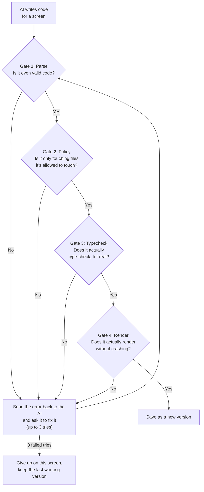

**Step by step, in plain English**:

1. The AI proposes a change to a screen's code.
2. Check 1 — Parse: is this even syntactically valid code? (Not garbled or cut off.)
3. Check 2 — Policy: is it only editing files it's allowed to touch, using only allowed imports?
4. Check 3 — Typecheck: run it through a real TypeScript compiler. Does it actually type-check — no made-up props, no wrong types?
5. Check 4 — Render: actually mount the component in a real (headless) browser-like environment. Does it crash?
6. If any single check fails, the exact error message is handed straight back to the AI as "here's what's wrong, please fix it" — up to 3 times.
7. If it still fails after 3 tries, the system gives up on that one screen and keeps whatever the last working version was, rather than leaving you with a broken app.
8. Only once all 4 checks pass does the change get saved as a new version you can see.

**Files involved**:

| File | Role |
|---|---|
| `lib/verify/types.ts` | Shared contracts: `Workspace`, `ChangeSet`, `Diagnostic`, `RunState` |
| `lib/verify/coder.ts` | `coderAdapter` — calls the real AI model, streaming, to produce a `ChangeSet` |
| `lib/verify/prompts.ts` | The coder and repair prompts |
| `lib/verify/protocol.ts` | Parses the model's tagged reply into a `ChangeSet` |
| `lib/verify/workspace.ts` | `applyChangeSet` — actually applies a `ChangeSet` to an in-memory `Workspace`; converts to/from the DB's `AppDoc` shape |
| `lib/verify/ownership.ts` | `isAppOwned` / `isPlatformOwned` — decides which files the AI is even allowed to touch |
| `lib/verify/pipeline.ts` | `verifyChange` / `verifyWorkspace` — runs the gates below *in order*, cheapest first, serialized by a lock (the render gate needs exclusive use of a shared DOM) |
| `lib/verify/gates/parse.ts` | Gate 1: is the code syntactically valid / in the expected file shape |
| `lib/verify/gates/policy.ts` | Gate 2: ownership rules, allowed imports, line-count limits |
| `lib/verify/gates/typecheck.ts` | Gate 3: a **real** `tsc` LanguageService check against `vendor/type-bundle` (a pinned, isolated `node_modules`) |
| `lib/verify/gates/render.ts` | Gate 4: headless **jsdom mount of the actual preview bundle** — not a mock, the same code that renders in the browser |
| `lib/verify/gates/bundle.ts` | A Metro-bundle-reachability gate, written but currently unused (would matter for a future "publish" feature) |
| `lib/verify/run.ts` | `runChange` — the state machine: write → verify → repair (≤3 rounds) → commit |
| `lib/agent/generation-guard.ts` | If a regeneration attempt fails entirely, keeps the previously-working version of that screen instead of leaving it broken |
| `lib/agent/repair-cap.ts` | Caps how many repair attempts a single runtime crash can trigger, project-wide |
| `lib/versions/store.ts` | `commitSnapshot` — on success, writes a new `app_snapshots` row and updates `projects.preview_screens` / `current_version` |

**How to explain it to someone technical**: "This is the single most important
design decision in the codebase. Early on, the AI just wrote files directly and the
result looked fine in the chat transcript but regularly crashed in the actual app.
Now every single AI code change — no matter how it was triggered — goes through the
same four gates: can it parse, is it allowed to touch what it's touching, does it
actually type-check against a real compiler, and does it actually render in the real
runtime. Only after all four pass does it get committed as a new version. If any gate
fails, the specific failure (a TS error message, a render exception) gets handed back
to the model as the next prompt, up to 3 times, before giving up on that piece."

---

## 4. The app manifest and platform kit (keeping structure safe)

**What it does**: screens, navigation, and data collections aren't just "whatever
files the AI wrote" — they're modeled explicitly, validated, and then
*deterministically* compiled into the actual layout/navigation/type files. The AI
edits the manifest's *entries* and screen bodies; it never hand-writes routing.
Separately, screens are built from a constrained component vocabulary rather than
raw React Native.

**The flow**:

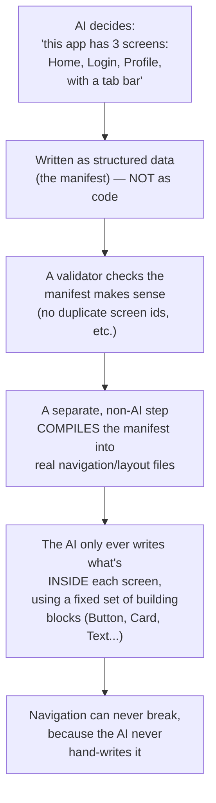

**Step by step, in plain English**:

1. When the AI plans an app, it doesn't write navigation code directly — it describes the structure (which screens exist, how they're organized into tabs, what data the app needs) as structured, validated data called the manifest.
2. That manifest gets checked for basic sanity (no two screens with the same name, etc.) before anything else happens.
3. A separate step — with no AI involved — reads the manifest and automatically writes the actual navigation/routing files. This step is deterministic: same manifest always produces the same files.
4. The AI is only ever allowed to write what goes inside each screen, and even then, only using a fixed toolbox of ready-made building blocks (a Button, a Card, a Text, a Screen) instead of raw React Native code.
5. Net effect: the AI literally cannot break your app's navigation, because it never gets to touch the code that implements navigation — only the structured description of it.

**Files involved**:

| File | Role |
|---|---|
| `lib/manifest/schema.ts` | Zod schema for `AppManifest` — screens, navigation, collections, with ownership awareness |
| `lib/manifest/migrate.ts` | `fromLegacy` / `ensureManifest` / `syncManifest` — builds/refreshes a manifest from the older `AppPlan` + `AppDoc` shape |
| `lib/manifest/compile.ts` | `compileManifest` — deterministically **generates** `app/_layout.tsx`, the tabs layout, `lib/nav.ts`, `data/types.ts` from the manifest. This output is never AI-written. |
| `lib/app-project/kit.ts` | `@/kit` — the typed component library the AI is steered toward: `Screen`, `Stack`, `Text`, `Button`, `Card`, etc. |
| `lib/app-project/icons.ts` | Shared icon vocabulary so the AI picks from a known set instead of guessing icon names |
| `lib/app-project/templates.ts` | Boilerplate platform files (theme, backend config) written into every new project |
| `lib/app-project/project.ts` | `compileForPreview`, `checkFile`, `ALLOWED_PACKAGES`, `autoImport` — browser-side compile step and import allow-list |
| `lib/app-runtime/app-doc.ts` | `AppDoc` — the full project document shape (screens/files/themes/data/manifest) stored in the DB |
| `lib/app-runtime/data-model.ts` | `DataModel` — collections/fields shape for a project's data |
| `lib/app-runtime/theme.ts` | `AppTheme` / `ThemePackage` + fallback theme generation |

**How to explain it to someone technical**: "Think of it as a firewall between
'things that would break the whole app if the AI gets them wrong' and 'things that
are fine for the AI to write freely.' Navigation and routing are compiled from a
validated manifest, not generated as free text — so the AI literally cannot produce
a broken nav tree. On top of that, screens are built from a typed component kit
instead of raw React Native primitives, which narrows the space of API misuse
mistakes the model can make."

---

## 5. Canvas, Preview, and tap-to-edit

**What it does**: the workspace shows the whole app as thumbnail screens on a
Canvas, and lets you open one screen full-size in an interactive Preview pane. Both
are live — they re-render immediately after any AI change. You can also tap an
element in either view to select it and edit it directly (text, color, spacing)
without going through chat at all.

**The flow**:

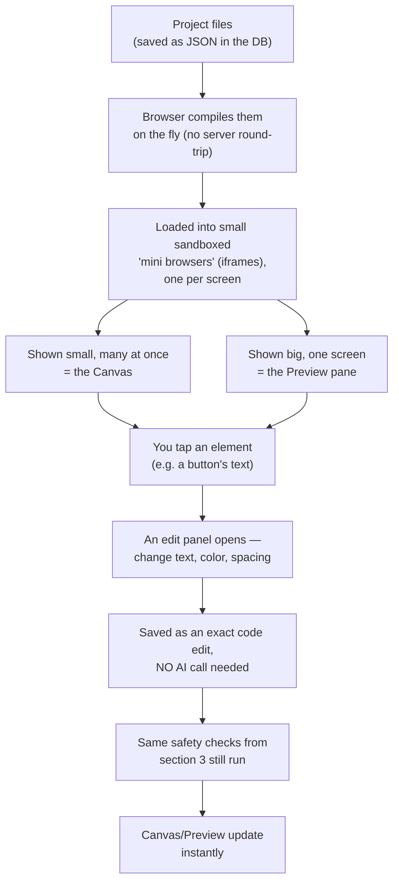

**Step by step, in plain English**:

1. Your project's files live as data in the database — not as files on a disk somewhere.
2. The browser compiles those files itself, live, whenever you open the workspace.
3. Each screen gets rendered inside its own small sandboxed "mini browser" (an iframe) — this keeps the preview isolated and safe.
4. The Canvas just shows many of these mini-browsers small, side by side. The Preview pane shows one of them big and interactive.
5. When you tap on something — say, a button — an editor panel opens letting you change its text, color, or spacing directly.
6. That edit does **not** call the AI. It's translated into an exact, surgical code change automatically.
7. That code change still has to pass the same safety checks as an AI-written change (§3) — it's just fast because there's no AI "thinking" step.
8. The Canvas and Preview update right away, so edits feel instant.

**Files involved**:

| File | Role |
|---|---|
| `components/workspace/app-runtime.tsx` | `AppRuntimeProvider` — compiles every project file client-side with Sucrase, manages one sandboxed `<iframe>` per rendered screen |
| `components/workspace/canvas-panel.tsx` | Canvas UI: draggable screen thumbnails, theme switcher, inline-edit overlay |
| `components/workspace/preview-panel.tsx` | Interactive single-screen preview, Inspect toggle, Expo QR dialog entry point |
| `lib/preview/protocol.ts` | The host↔iframe `postMessage` protocol: module/theme/data pushes, element selection, edit requests, RPC |
| `lib/preview/element-names.ts` | Human-readable naming for selected elements |
| `preview-runtime/bridge.ts` | Frame-side message handling + small reactive stores |
| `preview-runtime/router.tsx` | Expo-Router-like file-based router shim (the largest file in the runtime) |
| `preview-runtime/modules.ts` | Dynamic module resolution + a dev JSX factory that stamps every element with `data-eid="file:line:Tag"` so it can be targeted by the inspector/codemod |
| `preview-runtime/inspect.ts` | Hover/select/tap highlighting, optimistic local preview of an edit before it's committed |
| `preview-runtime/shims/*.ts` | React Native / Expo API stand-ins (native, ui, theme, backend) that run inside the sandboxed iframe |
| `scripts/build-preview.mjs` | esbuild-bundles all of `preview-runtime/` into the single `public/preview/runtime.js` every iframe loads (runs automatically before `dev`/`build`) |
| `components/workspace/element-editor.tsx` | The inline-edit side panel (replaced the older `element-inspector.tsx`) for editing a selected element's properties |
| `lib/verify/codemod.ts` | `applyElementEdit` / `parseEid` — turns a tap-to-edit change into an **AST-level text/style rewrite**, with **no AI model call**, then still runs it through the standard verify gates |

**How to explain it to someone technical**: "Canvas and Preview are the same
mechanism rendering the same compiled project in sandboxed iframes — Canvas just
shows many screens small, Preview shows one screen big and interactive. The clever
part is tap-to-edit: when you drag a slider to change a color or retype some text on
the canvas, that doesn't call the AI at all — it's parsed into an exact AST edit
(`lib/verify/codemod.ts`) and applied directly, then verified through the same gates
as an AI-written change. That's why small visual tweaks feel instant instead of
waiting on a model round-trip."

---

## 6. Code tab, diffs, and version history

**What it does**: a Code tab shows the actual project files (tagged
Platform/Generated/App-owned), a Changes tab shows a diff against the previous
version, and a version history menu lets you jump back to (restore) any earlier
snapshot.

**The flow**:

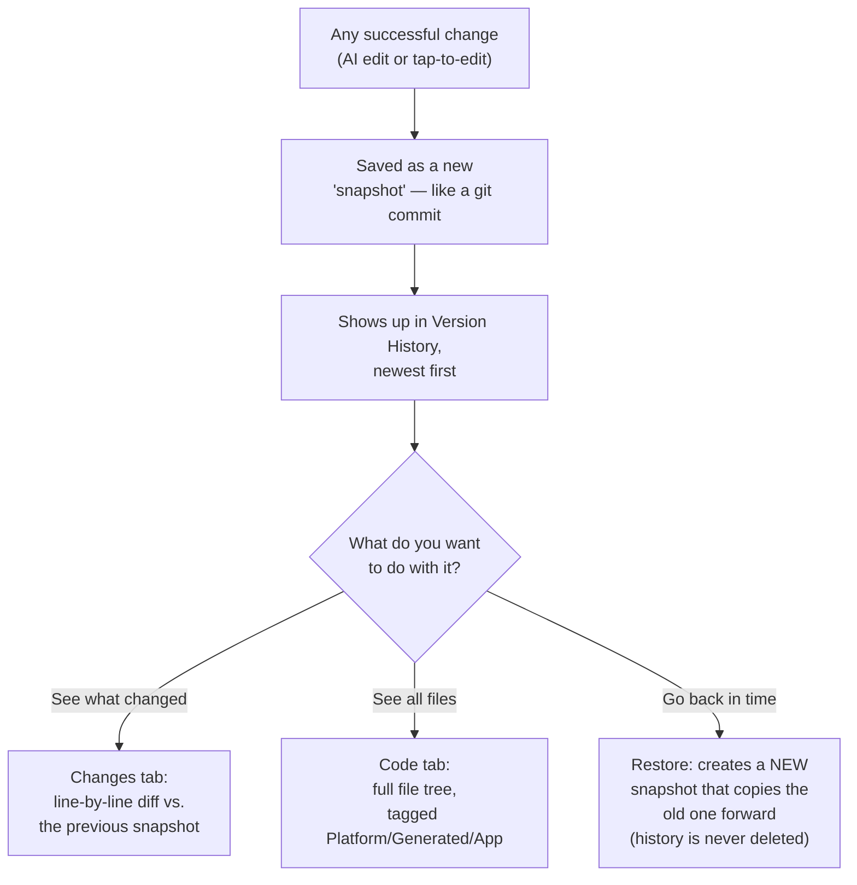

**Step by step, in plain English**:

1. Every time a change is successfully made — whether by the AI or by a tap-to-edit — it's saved as a new "snapshot", the same idea as a commit in git.
2. These snapshots show up in order in the version history menu.
3. The Code tab lets you browse every file in the current snapshot, with a label showing whether it's a platform file, an AI-generated file, or something you own/edited.
4. The Changes tab compares the current snapshot to the one right before it and shows you exactly which lines changed.
5. If you want to go back to an older version, Restore doesn't delete anything — it creates a brand-new snapshot that's a copy of the old one, placed at the end of history. So you can always restore forward again later if you change your mind.

**Files involved**:

| File | Role |
|---|---|
| `components/workspace/code-view.tsx` | Code tab UI: file tree, ownership badges, jump-to-line |
| `components/workspace/app-files.ts` | Builds the file tree + classifies each file's ownership (platform/generated/app) |
| `components/workspace/changes-view.tsx` | Diff viewer against a prior snapshot |
| `components/workspace/versions-menu.tsx` | Version list + restore action |
| `lib/versions/store.ts` | `commitSnapshot` / `listSnapshots` / `restoreSnapshot` over the `app_snapshots` table |
| `lib/versions/plan.ts` | Version numbering and pruning logic |
| `lib/versions/diff.ts` | A dependency-free LCS line-diff implementation used by the Changes tab |
| `app/api/projects/[projectId]/versions/route.ts` | `GET` — list snapshots |
| `app/api/projects/[projectId]/versions/[version]/restore/route.ts` | `POST` — restore a snapshot |
| `app/api/projects/[projectId]/versions/[version]/diff/route.ts` | `GET` — unified diff for a specific version |

**How to explain it to someone technical**: "Every successful AI change (or
tap-to-edit) is a commit — literally a new row in `app_snapshots`, same idea as a
git commit. The Changes tab diffs the current snapshot against the previous one with
a small hand-rolled line diff (no external diff library). Restoring a version just
points `projects` back at an older snapshot's files — it doesn't delete history, so
you can restore forward again later."

---

## 7. Real-device preview (QR to Expo Go)

**What it does**: instead of only viewing the app in the browser preview, you can
scan a QR code (or paste a link into Expo Go's "Enter URL manually") and see the
actual app running on a real phone — built once on the server and served as plain
files, not a locally-running Metro process the phone has to be on the same Wi-Fi to
reach.

**The flow**:

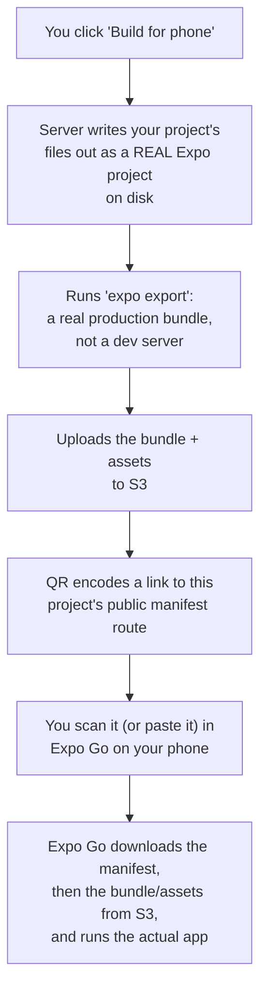

**Step by step, in plain English**:

1. You ask to build the app for your phone.
2. The server takes your project's files (the same ones used in the browser preview) and writes them out as a genuine, real Expo project on disk.
3. It runs `expo export` for that project — the same command a real Expo developer would run to produce a shippable bundle — and uploads every file it produces (plus the project's `app.json`) to S3.
4. The QR / link doesn't point at a Metro server at all; it points at this project's own manifest endpoint on this app's own server.
5. You open that link in Expo Go (same Wi-Fi isn't required once this is actually deployed — only while testing against a local dev server).
6. Expo Go fetches the manifest, which hands back pre-signed S3 links for the bundle and every asset; it downloads those and runs your actual app, same as it would for any published app.

Each project builds independently (its own S3 prefix, its own manifest route), so two people
can build and preview two different projects at the same time — unlike the Metro lane below,
which can only run one project's bundler at once. The tradeoff: no hot reload. After an edit,
you press "Rebuild", then have to force-close and reopen the app on the phone to pick it up —
Expo Go only re-fetches the manifest on a fresh launch, not while already running.

**Files involved**:

| File | Role |
|---|---|
| `lib/device/export.ts` | `exportExpoProject` — writes a project's files out as a real Expo project under `.device/<id>/` |
| `lib/device/build.ts` | Runs `expo export` and uploads its output to S3; tracks status in the `device_builds` table |
| `lib/device/manifest.ts` | Builds the Expo Updates protocol manifest (presigned S3 URLs) a ready build serves to Expo Go |
| `app/api/projects/[projectId]/device-build/route.ts` | `GET`/`POST` — authenticated status/start for a project's build |
| `app/api/device/[projectId]/manifest/route.ts` | **Public, unauthenticated** — what Expo Go actually fetches |
| `components/workspace/expo-qr.tsx` | The "Test on your phone" dialog: triggers a build, polls its status, renders the QR for the ready manifest URL |

**Still around, not currently reachable from the dialog**: `lib/device/lane.ts` (a local
Metro/`expo start` child process per project), `scripts/device-preview.ts` (its CLI entry
point), and `app/api/projects/[projectId]/device/route.ts` (dev-only status/start/stop for it).
This was the original mechanism — same Wi-Fi, live Metro, instant reload — and is the intended
fast dev-loop path long-term; the hosted flow above currently stands in for it everywhere while
it's being proven out. See `docs/verified-code-plan.md` Phase 10b for the full history
(including why Snack and a shared-Metro tunnel were ruled out) and what's still open.

---

## 8. Connect Backend (real Postgres/Auth/Storage)

**What it does**: a generated app starts with local/in-device fake storage. "Connect
Backend" provisions a *real* backend — Postgres, Auth, Storage — on CloudHike and
rewires the generated app to use it, without the AI needing to hand-write any backend
integration code.

**The flow**:

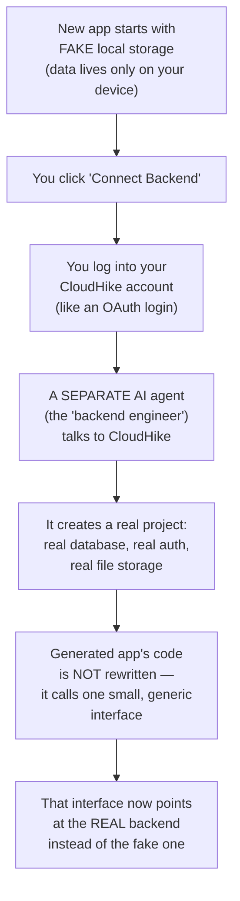

**Step by step, in plain English**:

1. A brand-new app only has fake, local storage — data lives on your device and nowhere else.
2. When you click "Connect Backend," you log into your CloudHike account (an OAuth-style login flow).
3. A second, completely separate AI agent — different from the one that writes your app's screens — takes over. Its only job is talking to CloudHike.
4. That agent provisions a real backend for you: a real database, real user accounts/auth, real file storage.
5. Here's the clever part: your generated app's code never changes. It was always written to call one small, generic interface for "save this data" / "who's logged in" / "store this file."
6. Connecting the backend just swaps what's behind that interface — from the fake local version to the real CloudHike-backed version — so nothing in your app's screens needs to be rewritten.

**Files involved**:

| File | Role |
|---|---|
| `components/workspace/backend-connect.tsx` | The "Connect Backend" UI flow |
| `lib/cloudhike/connect.ts` | OAuth-like "connect your CloudHike account" flow; stores the resulting token encrypted |
| `lib/cloudhike/config.ts` | Parses which CloudHike services are available/configured |
| `lib/cloudhike/mcp.ts` | Client for CloudHike's MCP server (the protocol used to actually provision resources) |
| `lib/cloudhike/provision.ts` | A dedicated "backend engineer" AI agent — runs its own tagged-reply loop calling CloudHike MCP tools to create a project and deploy services |
| `lib/cloudhike/app-backend.ts` | Reads/syncs the provisioned backend's schema and env vars back into the app project |
| `lib/cloudhike/owner.ts` | Ownership check helper used by backend-related routes |
| `lib/crypto/secret-box.ts` | Symmetric encryption for stored tokens/secrets |
| `lib/backend/types.ts` | `AppBackend` — the interface generated app code calls (db/kv/storage/auth) |
| `lib/backend/local-backend.ts` | In-browser/on-device fake implementation (used before a real backend is connected) |
| `lib/backend/cloudhike-backend.ts` | Real implementation that talks to a provisioned CloudHike project |
| `lib/backend/index.ts` | `createBackend` — factory that picks an implementation based on project config |
| `app/api/projects/[projectId]/backend/route.ts` | Backend status/setup endpoint |
| `app/api/projects/[projectId]/backend/data/route.ts` | Lets the workspace browse the connected backend's actual data |

**How to explain it to someone technical**: "Generated apps are written against one
small interface (`AppBackend`), never against CloudHike directly — so the same
generated code works whether or not a real backend is connected, it's just a
different implementation behind the interface. Provisioning the real backend is
itself done by a *second*, separate AI agent (`lib/cloudhike/provision.ts`) that's
allowed to call CloudHike's MCP tools — it's a different agent loop from the one
that writes your app's UI."

---

## 9. Export: Download as ZIP

**What it does**: exports the current project's complete file tree as a standalone, runnable Expo SDK 58 project packaged into a downloadable `.zip` archive. Unzipping it and running `npm install && npx expo start` gives a ready-to-run app.

**The flow**:

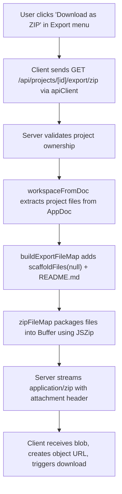

**Files involved**:

| File | Role |
|---|---|
| `lib/app-project/scaffold.ts` | Shared scaffold files (`babel.config.js`, generic `metro.config.js`, `.gitignore`, `README.md`) |
| `lib/app-project/zip-export.ts` | `buildExportFileMap` & `zipFileMap` (JSZip in-memory bundling) |
| `app/api/projects/[projectId]/export/zip/route.ts` | GET route returning the generated zip buffer as an attachment |
| `components/workspace/workspace-header.tsx` | Export dropdown menu item with loading spinner and error handling |

---

## 10. Export: Push to GitHub

**What it does**: connects a creator's GitHub account via OAuth and exports the complete project directly to a GitHub repository (new or existing) with real-time step-by-step progress streamed via SSE. Subsequent pushes can update the existing branch or branch off to a new branch.

**The flow**:

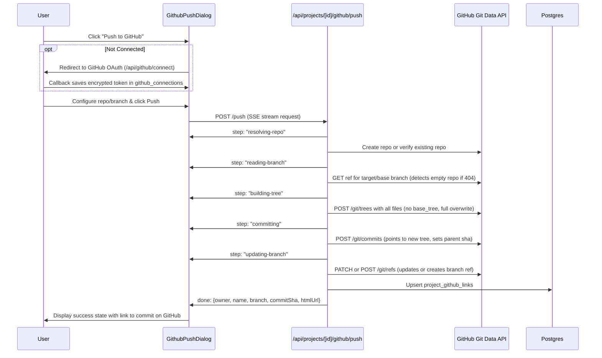

**Files involved**:

| File | Role |
|---|---|
| `lib/github/config.ts` | GitHub OAuth client configuration & environment validation |
| `lib/github/connect.ts` | OAuth authorization URL, state cookies, token exchange, and encrypted persistence |
| `lib/github/api.ts` | GitHub Git Database API client (`listRepos`, `createRepo`, `createTree`, `createCommit`, `updateRef`, etc.) |
| `lib/github/push.ts` | `pushProject` orchestration, full-tree-overwrite algorithm, and commit message formatting |
| `lib/http/sse.ts` | Generic Server-Sent Events headers and event encoder |
| `app/api/github/connect/route.ts` | Starts GitHub OAuth redirect flow |
| `app/api/github/callback/route.ts` | Completes OAuth handshake and stores encrypted access token |
| `app/api/github/status/route.ts` | Reports GitHub integration configuration and connection status |
| `app/api/github/repos/route.ts` | Lists user's repositories for the picker |
| `app/api/projects/[projectId]/github/route.ts` | Fetches project link metadata and server-computed suggested commit message |
| `app/api/projects/[projectId]/github/push/route.ts` | Executes push and streams real-time SSE progress events |
| `components/workspace/github-push-dialog.tsx` | Push dialog with connection states, repository/branch controls, and live step progress |
| `db/schema.ts` | `github_connections` and `project_github_links` tables |

---

## 11. Publish & EAS Builds: Native App Export & Web Hosting

**What it does**: compiles generated apps either into installable native packages (`.apk` / `.aab` for Android, `.ipa` for iOS) or publishes them as live websites via Expo EAS Hosting with a stable URL preserved across republishes. Offloads compute to the user's connected GitHub repository (GitHub Actions minutes) and their own Expo / EAS account. Links directly to EAS cloud-hosted artifacts and live web hosting URLs.

**The flows**:

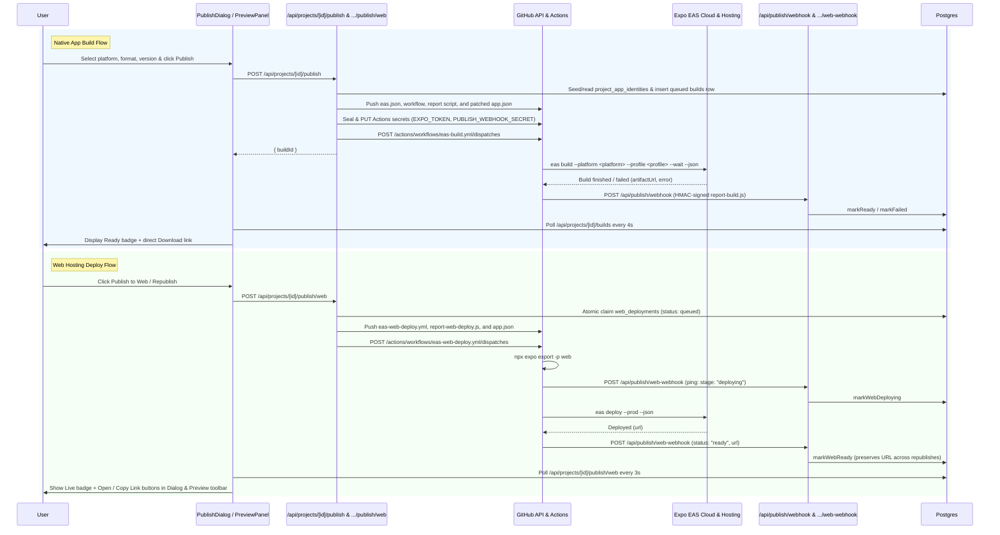

**Files involved**:

| File | Role |
|---|---|
| `components/workspace/publish-dialog.tsx` | Native build picker, web deployment tab with 4-step progress row (Preparing → Building → Deploying → Live), URL copy/open, and build history |
| `components/workspace/preview-panel.tsx` | Preview toolbar chip displaying active deploy stage or ready pill with live host and copy-link button |
| `components/workspace/expo-connect-dialog.tsx` | Token-paste dialog connecting user's Expo Personal Access Token to their account |
| `components/workspace/workspace-header.tsx` | Dropdown menu links to Expo Connect / Publish dialogs and dynamic Publish button |
| `lib/publish/dispatch.ts` | Shared helper extracting default branch resolution, project push, secret upsert, workflow dispatch, and correlation |
| `lib/publish/eas-config.ts` | Profile naming, `eas.json` generator, `app.json` patcher, and workflow/script template builders for native builds |
| `lib/publish/eas-web-config.ts` | `patchAppJsonForWebDeploy`, `buildWebDeployWorkflowYaml`, and `buildWebDeployReportScript` for EAS web hosting |
| `lib/publish/web-deploy.ts` | Web deployment database helpers: `claimWebDeployment`, `getWebDeployment`, `markWebDispatched`, `markWebBuilding`, `markWebDeploying`, `markWebReady`, `markWebFailed` |
| `lib/publish/run-web-deploy.ts` | Orchestrates web deploy: workspaces app doc → patches app.json → dispatches `eas-web-deploy.yml` workflow |
| `lib/publish/app-identity.ts` | Stable Android package name and iOS bundle identifier persistence (`project_app_identities`) |
| `lib/publish/github-secrets.ts` | Libsodium `crypto_box_seal` encryption for GitHub Actions repository secrets |
| `lib/publish/webhook-auth.ts` | Stripe-style HMAC-SHA256 signature generation and verification for publish webhooks |
| `lib/publish/expo-connect.ts` | Personal Access Token validation via Expo GraphQL API, AES-GCM encryption, and connection management |
| `lib/publish/builds.ts` | Query helpers for build row lifecycle (`createQueuedBuild`, `markDispatched`, `markReady`, `markFailed`) |
| `lib/publish/run-publish.ts` | End-to-end native publish orchestration: assemble files → patch `app.json` → dispatch via `dispatchProjectWorkflow` |
| `app/api/projects/[projectId]/publish/route.ts` | Endpoint to validate targets, insert queued build, and trigger native publish workflow |
| `app/api/projects/[projectId]/publish/web/route.ts` | POST: triggers web deploy with atomic claim; GET: returns current project web deployment |
| `app/api/projects/[projectId]/builds/route.ts` | Returns ordered list of builds for a project (polled by Publish dialog) |
| `app/api/projects/[projectId]/builds/[buildId]/retry/route.ts` | Retries a failed build by dispatching a new build attempt row |
| `app/api/publish/webhook/route.ts` | Unauthenticated, HMAC-verified webhook receiving native build results from GitHub Actions |
| `app/api/publish/web-webhook/route.ts` | Unauthenticated, HMAC-verified webhook receiving web deploy stage pings and terminal results |
| `app/api/expo/connect/route.ts` | Validates and saves an Expo Personal Access Token |
| `app/api/expo/status/route.ts` | Reports whether current user has an active Expo connection |
| `app/api/expo/disconnect/route.ts` | Disconnects the user's Expo account |
| `db/schema.ts` | `builds`, `web_deployments`, `project_app_identities`, and `expo_connections` tables with partial unique index |
| `.github/workflows/eas-build.yml` | Generated GitHub Actions workflow running in user's repo to execute EAS build |
| `.github/workflows/eas-web-deploy.yml` | Generated GitHub Actions workflow running in user's repo to export web and deploy via EAS Hosting |
| `.github/scripts/report-build.js` | Generated Node script running in user's workflow to sign and report native build results back |
| `.github/scripts/report-web-deploy.js` | Generated Node script running in user's workflow to sign and report web deploy stage & result back |
| `eas.json` | Generated EAS configuration file defining production profiles with remote versioning |

---

## 12. Authentication

**What it does**: sign-up/sign-in/sign-out (including social login) for the builder
app itself, delegated to CloudHike's own auth service rather than reimplemented here.

**The flow**:

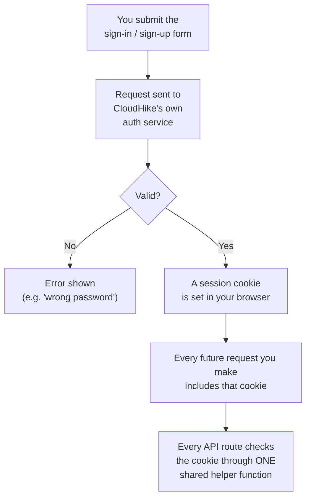

**Step by step, in plain English**:

1. You fill in the sign-in or sign-up form and submit.
2. The request is sent to CloudHike's own authentication service — this app doesn't manage passwords itself.
3. If something's wrong (bad password, email taken, etc.), you get a specific error message back.
4. If it succeeds, a session cookie is set in your browser.
5. From then on, every request your browser makes automatically includes that cookie.
6. Every protected part of the app (API routes) checks that cookie through one single shared helper, rather than each one re-implementing its own login check.

**Files involved**:

| File | Role |
|---|---|
| `components/auth/auth-dialog.tsx` | Sign-in/sign-up modal UI |
| `components/auth/auth-provider.tsx` | React context exposing the current user |
| `components/auth/social-icons.tsx` | OAuth provider buttons |
| `app/api/auth/{session,sign-in,sign-up,sign-out,social}/route.ts` | Cookie-session endpoints; `social` exchanges a CloudHike-issued token for the local session cookie |
| `lib/cloudhike-auth.ts` | Verifies tokens against CloudHike's auth service |
| `lib/session.ts` | Cookie get/set/clear helpers |
| `lib/users.ts` | `ensureUser` — upserts a local `users` row mirroring the CloudHike-side user |
| `lib/current-user.ts` | `getCurrentUser`-style helper every API route uses; throws a `ServiceUnavailableError` if there's no session |

**How to explain it to someone technical**: "This app doesn't own its own user
accounts — it mirrors CloudHike's. Every protected API route calls the same one
helper (`lib/current-user.ts`) to get the current user or fail consistently, rather
than each route re-implementing auth checks."

---

## 12. Asset/file serving

**What it does**: images and other binary assets attached to a prompt, or generated/
used by a project, are stored in S3-compatible storage and served back through the
app rather than directly from the storage provider.

**The flow**:

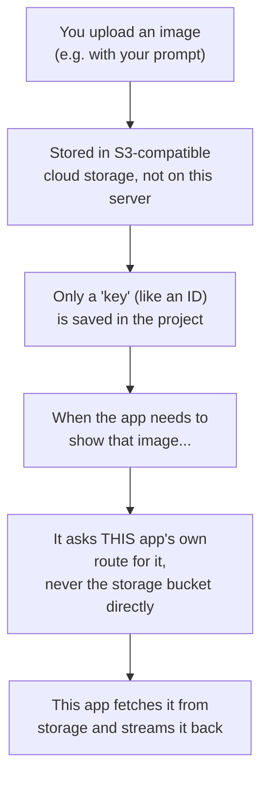

**Step by step, in plain English**:

1. When you upload an image (say, attaching a reference photo to your prompt), it's stored in S3-compatible cloud storage — not saved directly on this server.
2. Only a short reference ("key") to that file is kept in the project's data.
3. When anything in the app needs to display that image later, it never talks to the storage bucket directly.
4. Instead, it asks this app's own file-serving route for it, using the project ID and the key.
5. That route fetches the real file from storage and streams it back — acting as a safe middleman so raw storage URLs/credentials are never exposed to the browser.

**Files involved**:

| File | Role |
|---|---|
| `lib/storage.ts` | Upload/fetch helpers against S3-compatible storage (AWS SDK) |
| `app/api/app-files/[projectId]/[...key]/route.ts` | Serves a stored asset by key, scoped to a project |

---

## 13. Homepage: project cards, previews, and public sharing

**What it does**: signed-in users see their own projects on the homepage as cards
with a live, always-current mini preview of the app (not a stale screenshot) and a
three-dot menu (Open, Rename, Duplicate, Share, Export, Delete). Sharing a project
makes it visible to signed-out visitors in a public gallery; clicking a public card
opens a dialog where the visitor can actually use the generated app — real UI,
sandboxed sample data — without signing up.

**The flow**:

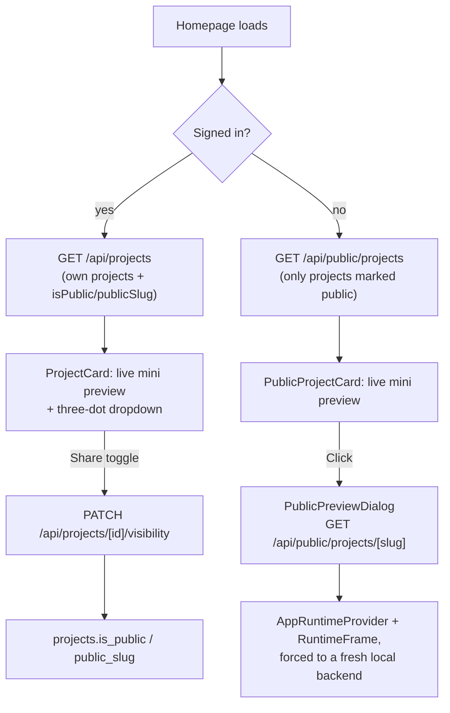

**Step by step, in plain English**:

1. Every project card's preview is a real, live render of the app's first screen — it lazily mounts the same sandboxed iframe runtime the workspace canvas/preview uses (`RuntimeFrame`/`AppRuntimeProvider`), scaled down. There's no separate screenshot pipeline to keep in sync.
2. The three-dot menu on an owner's card calls one small owner-only route per action: rename and delete share `app/api/projects/[projectId]/route.ts` (PATCH/DELETE), duplicate and visibility each get their own sub-route, and Export reuses the existing `export/zip` route.
3. Turning "Share" on sets `projects.is_public = true` and generates a `public_slug` the first time (kept stable afterward). That's what makes the project show up in `GET /api/public/projects` and resolvable at `/p/[slug]`. The same toggle is also reachable from inside the workspace itself, via the header's Export menu → "Share project…" (`components/workspace/workspace-header.tsx`'s `ShareDialog`), which calls the identical `visibility` endpoint.
4. A signed-out visitor clicking a public card never gets the owner's real data or connected backend: the preview always runs against a brand-new `LocalBackend` (seeded from the project's own sample data, isolated to the visitor's browser), regardless of what the project is actually configured to use.
5. The same public payload (`screens`, `themes`, `dataModel`, `files`) also powers a standalone `/p/[slug]` page, so a shared link works for someone who never visits the homepage gallery.

**Files involved**:

| File | Role |
|---|---|
| `components/home/app-gallery.tsx` | Fetches + lays out the signed-in and signed-out grids |
| `components/home/project-card.tsx` | Owner's card: dropdown (rename/duplicate/share/export/delete dialogs) |
| `components/home/public-project-card.tsx` | Visitor's card: opens the preview dialog |
| `components/home/card-preview.tsx` | Lazy-mounted live mini render shared by both card types |
| `components/home/public-preview-dialog.tsx` | Fetches a public project client-side and renders it interactively |
| `components/home/public-app-player.tsx` | Shared `AppRuntimeProvider` + `AppPreview` wiring (local-only backend), used by the dialog and the `/p/[slug]` page |
| `app/p/[slug]/page.tsx` | Standalone public page for a shared link (server-fetches, no client round trip) |
| `db/projects.ts` | `renameProject`, `deleteProjectForUser`, `duplicateProject`, `setProjectVisibility`, `listPublicProjects`, `getPublicProjectBySlug` |
| `db/sql/project-visibility.sql` | Adds `is_public` / `public_slug` to `projects` |
| `app/api/projects/[projectId]/route.ts` | PATCH (rename) / DELETE |
| `app/api/projects/[projectId]/duplicate/route.ts` | POST |
| `app/api/projects/[projectId]/visibility/route.ts` | PATCH |
| `app/api/public/projects/route.ts` | GET (unauthenticated list) |
| `app/api/public/projects/[slug]/route.ts` | GET (unauthenticated single-project preview payload) |
| `lib/app-runtime/app-doc.ts` | `projectFilesFromDoc`, `plannedRoutesFromScreens` — shared helpers also used by the workspace |

---

# Part 2: Deep Dives (technical internals)

Part 1 above explains *what* each feature does and roughly how. This part is for
when you need the exact mechanics: state machines, concurrency, the real algorithm
inside a gate. These sections assume you've read the matching feature section above
(§2 for D1-D4, §3 for D5-D7, §5 for D8).

---

## D1. The agent run lifecycle (mutex, heartbeat, SSE resume)

**What problem this solves**: only one AI job should ever run on a project at once,
runs must survive a server restart or a crashed worker, and a client should be able
to refresh mid-run and pick up exactly where the stream left off — without an
in-memory server state that would break all three of those guarantees.

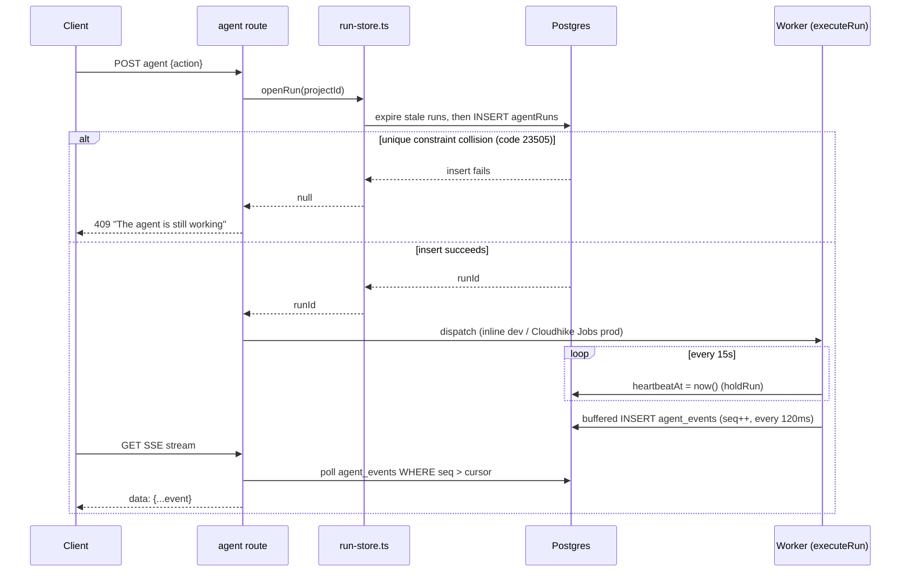

- **The mutex is a real DB unique constraint**, not an in-memory lock: `openRun`
  tries an `INSERT` into `agentRuns` and catches Postgres error `23505` (unique
  violation) as "someone else already has an active run for this project" — it
  returns `null` rather than throwing, and the route turns that into a `409`.
- **Staleness, not a graceful shutdown hook, is what frees a dead run**: a
  `running` run with no heartbeat for 90s, or a `queued` run older than 15 minutes,
  is swept by `expireStaleRuns`/`expireIfStale` the next time *anyone* calls
  `openRun` — so a crashed worker's lock self-heals the next time a request comes in,
  with no cron job needed.
- **Events are a log, not a live stream, under the hood.** `createEventSink`
  buffers events in memory, merges consecutive deltas for the same message/screen
  (so a thousand one-character `text` deltas become far fewer DB rows), and flushes
  every 120ms (or immediately on `done`/`error`). Writes are serialized through a
  `chain: Promise<void>` so two flushes can never interleave and corrupt `seq`
  ordering.
- **Resuming a stream is "replay the log from your cursor," not "hope the socket
  stayed open."** A client that (re)connects sends its last-seen `seq`; the server
  polls `agent_events WHERE seq > cursor` in a loop (150ms while actively streaming,
  500ms once idle) and also separately polls the `agent_runs` row itself every 3s to
  notice a run finishing without a trailing event. A brand-new joiner gets a
  synthetic `snapshot` event (the current folded state) instead of being forced to
  replay every delta from the beginning.
- **In-process state is deliberately almost nothing.** `registry.ts`'s `LiveRun` is
  just `{projectId, runId, emit}` — a place to push events, not a place that holds
  "what happened so far." The actual run snapshot is *derived* on demand from the
  persisted event log (`foldSnapshot`). This is what makes a run resumable from a
  *different* server process than the one that started it.

---

## D2. The orchestrator's planning flow

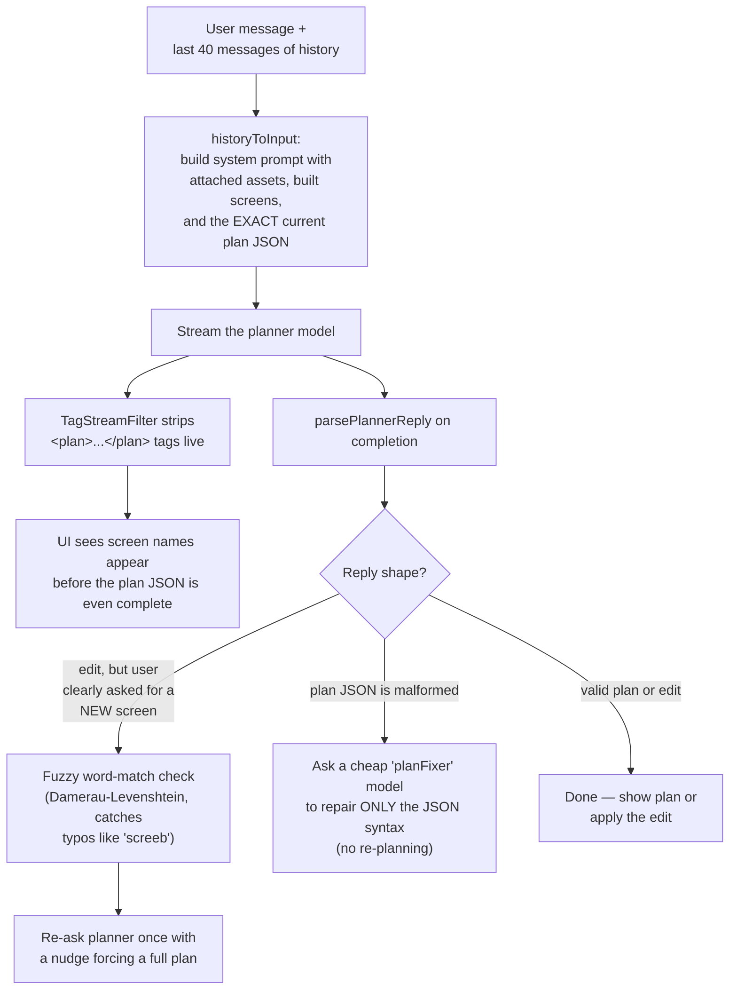

- The planner always sees the **current plan verbatim**, not a description of it —
  this matters because a later check (`onlyAddsScreens`) does an exact structural
  diff between the old and new plan to decide whether a revision needs
  re-approval; if the model reconstructed unchanged screens slightly differently,
  that diff would misfire.
- Streaming is resilient to flaky starts: `streamText` retries up to 3 times, but
  **only if nothing has streamed yet** — once the first token arrives, a failure
  mid-stream is not retried (you'd get a duplicated partial reply). A
  `finish_reason: "length"` truncation gets a special retry with reasoning disabled
  and a higher token budget, rather than being treated as a normal failure.
- `onlyAddsScreens` is deliberately conservative: a plan revision can skip
  re-approval only if every existing screen's id/name/presentation and the whole
  design block are byte-identical, and the only `navigatesTo` change allowed on an
  existing screen is *gaining* a link to a brand-new screen — never losing or
  changing one. Anything else requires the user to approve again.

---

## D3. The orchestrator's generation flow (building the app)

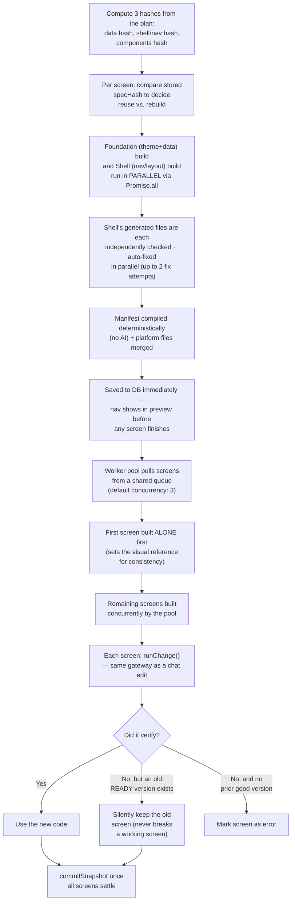

- Foundation and shell really do run in `Promise.all` together, not
  sequential-but-labeled-parallel — and each is skipped entirely (no model call at
  all) if its hash didn't change from the last build.
- The AI never writes an image URL itself (`lib/agent/prompts.ts`'s data rules: an
  `"image"` field is always `""` in the model's seed JSON). When a collection has an
  image field, the AI also sets that collection's `category` to its closest match from
  `IMAGE_LIBRARY_CATEGORIES` (`lib/image-library/categories.ts`: `avatars`, `beauty`,
  `books`, `clothing`, `electronics`, `fitness`, `food`, `home`, `jewelry`, `shoes`,
  `vehicles`), or omits it if nothing fits. Right after the foundation step produces
  that data, `lib/agent/seed-images.ts`'s `fillSeedImages()` fills every blank
  `"image"` field. It queries the curated ImageKit library first
  (`lib/image-library/match.ts`, querying `image_library` via Postgres full-text
  search + tags, with per-run de-duplication for variety). When the collection has a
  `category`, the query is **hard-filtered** to it — without that, a single shared
  word (e.g. "leather") could match an unrelated category's image (a watch instead of
  a shoe) purely on text overlap; with no `category` to filter on, it instead falls
  back to requiring 2+ overlapping tokens as a weaker safety net against that same
  single-word-fluke problem. If still no match meets the rank threshold, it records
  the query in `image_library_misses` (`lib/image-library/misses.ts`, upserting and
  bumping `hit_count`) and falls back to `lib/stock-images/index.ts`, backed by
  https://picsum.photos (free, keyless fallback so a field is never blank). It only
  ever fills blanks, so a photo an earlier build or a manual edit already set survives
  later rebuilds (the data model is cache-keyed by hash, same as everything else in
  this step). Screens bind `<Image>` straight to that field (`lib/agent/prompts.ts`'s
  TECH_RULES) rather than ever hardcoding a URL literal.
- The screen worker pool has no explicit lock: it's `queue.shift()` inside plain
  async functions, which is race-free because JavaScript's event loop never
  preempts synchronous code — the `.shift()` call itself can't be interrupted
  mid-way by another worker.
- `generation-guard.ts`'s rule is the key reliability property of the whole
  generation step: **a failed regeneration can never make a screen worse than it
  was.** If screen X was `ready` before this run and the new attempt fails
  verification, the orchestrator just keeps the old code. Only a screen that never
  had a working version becomes `error`.
- Progress saves from multiple concurrent screen workers are serialized through a
  `saveChain: Promise<void>` — the exact same "promise chain as a queue" pattern
  used for the SSE event sink in D1.

---

## D4. Three ways code gets changed — one gateway, three entry points

A screen's code can change via a chat message, a canvas tap, or an automatic crash
repair. Only one of the three calls the AI.

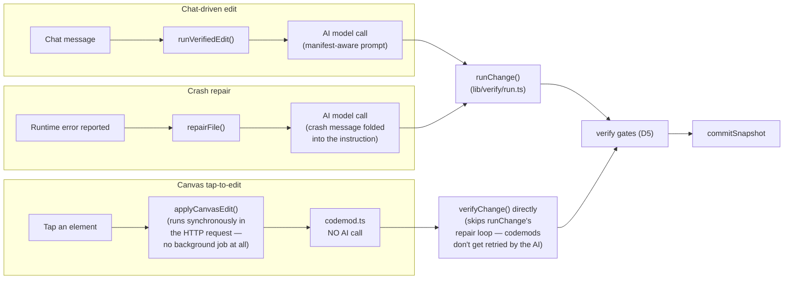

- **Canvas edits bypass the whole job system.** `applyCanvasEdit` isn't dispatched
  through `openRun`/`executeRun` at all — it runs synchronously inside the HTTP
  request handler, because there's no AI call to wait on, just an AST rewrite plus
  the (fast) verify gates.
- **Crash repair reuses the exact same `runChange` state machine (D6) as a chat
  edit** — the crash message is simply folded into the instruction text sent to the
  model ("X crashed with: ..."), and `repair-cap.ts` (an in-memory
  `project:version:path → expiry` map, 30 min TTL) guarantees at most one repair
  attempt is ever claimed per exact file version, independent of whatever the
  client does.
- **`describeElement`** (used by canvas-driven *chat* messages, e.g. "make this
  blue" while an element is selected) turns a tapped element into one sentence of
  prompt text identifying the screen, source line, and visible text, so the model's
  "it"/"this" pronouns resolve correctly.

---

## D5. Inside the verify pipeline: how each gate actually works

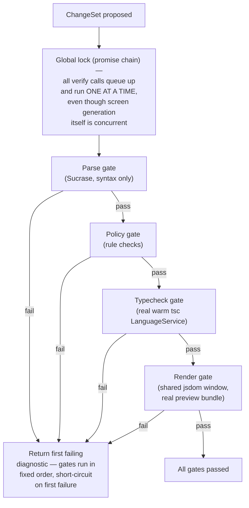

**Why one global lock?** Two of the gates mutate *shared, module-level* state that
isn't safe for concurrent access: the render gate reuses one jsdom `Window` singleton
(creating a fresh browser-like DOM per check would be far slower), and the typecheck
gate reuses a warm `ts.LanguageService` with an in-memory virtual file system. So
every `verifyChange` call — even though up to `SCREEN_CONCURRENCY` (default 3)
screens are being *generated* in parallel — queues up on a single
`lock = lock.then(() => work())` promise chain and actually verifies one at a time.
This isn't a mutex library; it's a plain JS promise used as a FIFO queue.

### Parse gate (`lib/verify/gates/parse.ts`)
Uses **Sucrase**, not Babel or the TypeScript compiler — fast, syntax-only
transform with `transforms: ["typescript", "jsx"]`. A parse failure is just Sucrase
throwing; the error text is regex-scraped for `(line:col)` to build a `Diagnostic`.
Only checks files that actually changed (or all files, for a fresh build).

### Policy gate (`lib/verify/gates/policy.ts`)
A fixed rule list, in order:
1. **File length** — max 300 lines, but only blocks if the file *grew* past the
   limit; a pre-existing long file isn't retroactively punished.
2. **Import resolution** — every import must be a platform module, a `@/`/relative
   path to a real project file, or on an explicit allowlist of npm packages.
3. **Every `app/*` file needs a default export.**
4. **Forbidden APIs** — `fetch(`, `XMLHttpRequest`/`WebSocket`, `eval(`/
   `new Function(` are blocked outright (checked with comments stripped first).
5. **Hardcoded colors** — more than 2 hex/rgba literals (excluding pure black/white)
   is a *warning*, not a blocker, nudging the model toward theme tokens without
   failing the build over it.

### Typecheck gate (`lib/verify/gates/typecheck.ts`)
A genuinely **warm, reused** `ts.LanguageService` (not recreated per call) — up to
8 are kept in an LRU cache, evicted after 10 minutes idle. Project files are mapped
into a virtual file system with version numbers that only bump when content actually
changes, so an unchanged file never invalidates the compiler's cached work; the real
`vendor/type-bundle` package types are read once and cached forever (they never
change at runtime). Diagnostics are filtered: syntax errors always block; semantic
errors only block if they're in a curated list (missing name/export, type
mismatches, property-doesn't-exist, possibly-null, invalid JSX component) —
everything else downgrades to a non-blocking warning.

### Render gate (`lib/verify/gates/render.ts`)
The deepest gate. One shared jsdom `Window` (created once, reused for every check)
loads the **actual** `public/preview/runtime.js` — the exact same bundle the real
browser preview runs, not a mock. A few browser APIs jsdom lacks are shimmed
(`ResizeObserver`, `matchMedia`, `reportError`). The gate "speaks" the same
`postMessage` bridge protocol the real browser host does, with one deliberate
workaround: jsdom's synthetic `postMessage` doesn't set `MessageEvent.source`, which
the bundle's own bridge checks before accepting a message — so host→frame messages
are dispatched manually as `new MessageEvent("message", {data, source: window})` to
satisfy that check. An in-memory fake backend seeded from the project's sample data
implements real `db.insert/update/remove` against an in-memory snapshot (everything
else — auth, file storage, theme/UI calls — is a safe no-op).

Per screen, the gate: mounts the screen, waits 40ms to settle, then checks for (a)
any error reported over the bridge, (b) a "blank screen" heuristic (no text, no
input/image at all), (c) console errors matching React's infinite-render-loop
messages. It also tries a real record id and a deliberately missing id (tests the
not-found path), then clicks up to 12 buttons one at a time via real synthesized
`MouseEvent`s, stopping at the first one that throws. Only screens that changed, or
that import something that changed, are mounted — not the whole app on every edit.

### Bundle gate (`lib/verify/gates/bundle.ts`) — written, not wired in
Fetches Metro's real bundle endpoint for iOS and Android, which would catch native-
module/babel-resolution errors the headless jsdom gate can't see. Not in the active
`GATES` list because it requires a running local Metro process (device preview);
reserved for a future on-demand or device-preview-time check.

---

## D6. The repair state machine

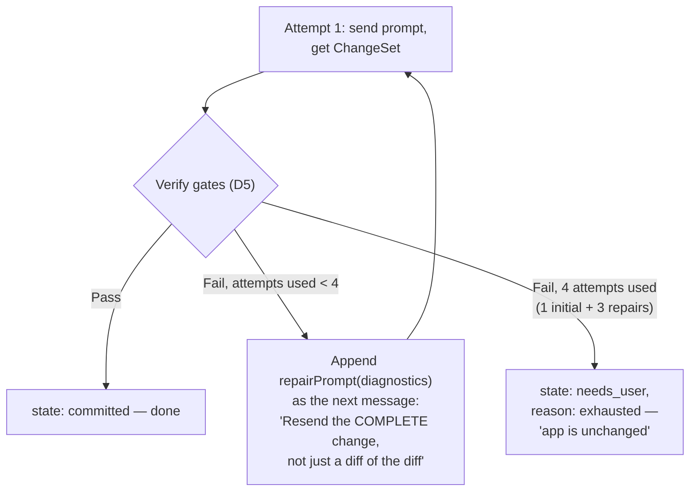

- Up to **4 total model calls**: 1 initial attempt + `MAX_REPAIRS = 3` repair
  rounds. Every attempt — pass or fail — is recorded with timing (`modelMs`,
  `gatesMs`) and emitted to the UI as an `attempt` event, which is what powers the
  attempt log you can see per screen.
- The repair prompt explicitly tells the model the app is *unchanged* (nothing was
  applied) and that it must resend the **entire** `ChangeSet`, not a patch — this
  avoids a whole class of bugs where a partial repair reply silently drops a file
  the model thinks is "already fine."
- Diagnostics text fed into the repair prompt is capped at 12 lines
  (`[gate] file:line:col message`, warnings excluded, with a "…and N more" tail) so
  a screen with many small issues doesn't blow the prompt budget.
- If the model replies with only a clarifying `<question>` and no code at all, the
  loop exits immediately as `needs_user`/`"question"` — no gate run happens, because
  there's nothing to verify yet.
- `runChange` itself never touches the database — it only returns a verified
  in-memory `Workspace`. The caller (orchestrator) is responsible for converting
  that into the DB's `AppDoc` shape and calling `commitSnapshot`. This keeps
  `lib/verify/**` entirely free of DB access, as documented in the architecture doc.

---

## D7. The fast router — skipping the planner for small edits

```mermaid
flowchart TD
    A["Chat message arrives"] --> B{"Does the project already\nhave ready screens + a manifest?"}
    B -- "No" --> C["Skip the router entirely —\ngo straight to the full planner"]
    B -- "Yes" --> D["One cheap, fast LLM call\n(maxTokens: 400,\ntagged-reply format)"]
    D --> E{"Classified as..."}
    E -- "question" --> F["Answer directly from\nproject structure —\nno file changes at all"]
    E -- "edit" --> G["Route straight to\nrunVerifiedEdit() with the\nnamed target screens —\nskips the full planner"]
    E -- "add_screen / structure" --> H["Always falls through to\nthe full planner\n(router never attempts\nthese itself)"]
    E -- "integration" --> I["Explain the capability gap —\nno ChangeSet produced"]
    E -- "unsupported" --> J["Ask a clarifying question"]
```

This is a real (cheap, fast-model) LLM call, not a keyword matcher — but it's
deliberately conservative: the prompt instructs it that when confidence is low, it
should default to `"structure"` (slow but correct — falls through to the full
planner) rather than guess `"edit"` and risk mis-scoping a change. `add_screen` and
`structure` are *always* handed to the full planner regardless of what the router
decides, by design — the router's only real "win" cases are `question` and `edit`.

---

## D8. The codemod engine — how tap-to-edit becomes a code change with no AI

```mermaid
flowchart TD
    A["Client sends: eid = 'app/home.tsx:42:Text',\nnew text or style"] --> B["parseEid: regex split into\n{file, line: 42, tag: 'Text'}"]
    B --> C["Parse the REAL file with the\nTypeScript compiler API\n(full AST, TSX mode)"]
    C --> D["Find every JSX element whose\nopening tag starts on line 42"]
    D --> E{"More than one\ncandidate, ambiguous?"}
    E -- "Yes" --> F["Refuse — return an error\nrather than guess"]
    E -- "No" --> G{"Text edit or style edit?"}
    G -- "Text" --> H["Find the single text child\nor matching string attribute,\npreserve surrounding whitespace\n(keeps line numbers stable)"]
    G -- "Style" --> I["Only ~30 allow-listed RN style\nkeys; numeric props stripped of\n'px', theme-aware colors resolved\nvia useTheme()"]
    H --> J["Build a list of exact\ntext Spans (start/end/replacement)"]
    I --> J
    J --> K["Apply spans in REVERSE order\nso earlier edits don't shift\nlater offsets"]
    K --> L["Still runs through the\nverify gates (D5) —\njust with no AI round-trip"]
```

- The `eid` format (`file:line:tag`) is produced client-side, not here —
  `preview-runtime/modules.ts`'s dev JSX factory stamps every rendered element with
  its source file/line/tag the moment it's created, so the id is always traceable
  back to real source.
- Ambiguity is handled by refusing, never guessing — if more than one JSX element on
  that exact line matches, the edit fails cleanly instead of silently editing the
  wrong one.
- A theme-aware color edit (`"theme:accent:#ff6600"`) will actually insert a
  `const theme = useTheme();` line into the component if one doesn't already exist
  and `useTheme` is importable — the codemod can add a small amount of new code,
  not just rewrite existing values.
- A non-object `style={styles.foo}` reference is wrapped into a style *array*
  (`[styles.foo, { ...overrides }]`) rather than parsed, since React Native accepts
  arrays of styles — this avoids needing to understand an external `StyleSheet`
  definition at all.

---

# Part 3: Concepts & a full worked example

Part 1 covers *what* each feature does; Part 2 covers *how the mechanisms work*.
This part answers two more basic questions — "what even is a manifest/kit, and why
does it exist" — and then walks one app through its *entire* life, start to finish,
showing the real data at every step.

---

## C1. What is "the manifest," and why does it exist?

**In one sentence**: the manifest is a strict, validated JSON description of your
app's *structure* — its screens, how they're organized into tabs, and what data it
stores — kept completely separate from the actual code, so the navigation and data
types can be generated by a dumb, deterministic compiler instead of by the AI.

```mermaid
flowchart LR
    A["User intent\n('a recipe app with\na list and a detail page')"] --> B["AppManifest\n(strict JSON, validated)"]
    B --> C["compileManifest()\n— pure function, no AI,\nsame input always gives\nthe same output"]
    C --> D["app/_layout.tsx\napp/(tabs)/_layout.tsx\nlib/nav.ts\ndata/types.ts"]
    B -.->|"AI never writes\nthese files directly"| D
    B --> E["AI writes screen BODIES,\nreferencing lib/nav.ts\nand data/types.ts\nthat the compiler made"]
```

**Why this exists, not just "the AI writes whatever files it wants":** navigation
and routing are the kind of thing where *one wrong file* breaks the entire app —
not just one screen. Earlier versions of this product let the AI hand-write
navigation code, and it would occasionally produce a subtly broken tab bar or a
dangling route that crashed the whole preview. The fix wasn't "write a better
prompt" — it was to stop letting the AI touch that code at all. The manifest is the
*only* thing the AI (or a user edit) is allowed to change about structure; a
completely separate, non-AI compilation step turns that structure into real files,
the same way every time.

**What's actually in one** (simplified from the real Zod schema in
`lib/manifest/schema.ts`):

```json
{
  "schemaVersion": 1,
  "app": { "name": "Recipe Box", "slug": "recipe-box" },
  "screens": {
    "home": { "title": "Recipes", "presentation": "tab", "icon": "restaurant-outline", "collection": "recipes" },
    "profile": { "title": "Profile", "presentation": "tab", "icon": "person-outline" },
    "recipe-detail": {
      "title": "Recipe",
      "presentation": "stack",
      "params": { "id": "string" },
      "collection": "recipes"
    }
  },
  "navigation": { "tabs": ["home", "profile"], "initial": "home" },
  "collections": {
    "recipes": {
      "label": "Recipes",
      "fields": {
        "title": { "type": "string", "label": "Title" },
        "minutes": { "type": "number", "label": "Cook time (min)" },
        "photo": { "type": "image", "label": "Photo" }
      },
      "seed": [{ "id": "recipes-1", "title": "Weeknight Pasta", "minutes": 20, "photo": "https://example.com/pasta.jpg" }]
    }
  }
}
```

A few deliberate design choices worth calling out:
- Every object is `.strict()` — an unknown field is a validation error, not silently ignored.
- `presentation: "stack"` screens (like `recipe-detail`) are correctly **not** listed in `navigation.tabs` — they're pushed onto the stack from another screen, not a tab destination.
- `validateManifest()` checks *cross-references* too, not just shapes: every tab screen must actually be in `navigation.tabs` and vice versa, every `icon` must exist in the app's known icon set, every `collection` reference must point at a real collection. These come back as the same `Diagnostic` shape the verify gates use (gate name `"manifest"`), so a broken manifest is caught the same way a broken screen is.
- `lib/manifest/migrate.ts`'s `fromLegacy` is what turns a looser, prose-friendly `AppPlan` (see E3 below) into this strict shape — the plan is what the AI reasons in; the manifest is what the compiler trusts.

---

## C2. What is `@/kit`, and why does it exist?

**In one sentence**: `@/kit` is a small, fixed set of pre-built, pre-themed UI
components (`Screen`, `Button`, `Card`, `Text`, `ListItem`, ...) that the AI is
steered to build every screen out of, instead of writing raw React Native/Expo
primitives from scratch every time.

```mermaid
flowchart TD
    A["Without a kit:\nAI writes raw &lt;View style={{...}}&gt;\nfor every button, every card,\nevery list row — every time"] --> B["Lots of surface area\nfor small styling mistakes\nand inconsistent spacing/colors"]
    C["With @/kit:\nAI writes &lt;Button label=... /&gt;\nand &lt;Card&gt;...&lt;/Card&gt;"] --> D["Kit components read all\nstyling from useTheme()\ninternally — AI can't\nhardcode a bad color"]
    D --> E["Every app automatically\nlooks visually consistent,\nand the policy gate can\nflag raw hardcoded colors\nas a warning"]
```

**Why this exists**: a component library isn't just about saving the AI typing
effort — it's a second narrowing mechanism, like the manifest, but for *visual*
code instead of *structural* code. If the AI could write arbitrary `<View
style={{backgroundColor: "#ff00aa"}}>` anywhere, every screen could end up visually
inconsistent, and the AI would occasionally pick colors or spacing that clash with
the app's actual theme. By giving it a closed vocabulary where every component
*already* pulls its colors and spacing from the active theme internally, visual
consistency becomes the default, not something the AI has to get right from
scratch on every single screen.

**The real component list** (from `lib/app-project/kit.ts`): `Screen`, `Stack`,
`Row`, `Text` (with a `variant`: title/heading/body/caption/label), `Card`,
`Button` (`variant`: primary/secondary/ghost/danger), `IconButton`, `ListItem`,
`Stat`, `ProgressBar`, `TextField`, `Toggle`, `EmptyState`, `Badge`, `Icon`,
`Section`, `Divider`. Every one of them reads from `useTheme()` — *none* of them
accepts a raw color prop as their primary styling mechanism.

**What AI-generated screen code actually looks like**, using only this vocabulary
(the real "Recipes" list screen for the example app used throughout this doc):

```tsx
import * as React from "react"
import { Screen, Section, ListItem, EmptyState } from "@/kit"
import { useCollection } from "@/lib/backend"
import { go } from "@/lib/nav"

export default function Home() {
  const { data: recipes } = useCollection("recipes")

  return (
    <Screen>
      <Section title="Recipes">
        {recipes.length === 0 ? (
          <EmptyState title="No recipes yet" message="Add your first recipe to get started." />
        ) : (
          recipes.map((r) => (
            <ListItem
              key={r.id}
              title={r.title}
              subtitle={`${r.minutes} min`}
              onPress={() => go("recipe-detail", { id: r.id })}
            />
          ))
        )}
      </Section>
    </Screen>
  )
}
```

Notice there is not a single hardcoded color, font size, or spacing value anywhere
in this file — every visual decision is delegated to the kit components and the
active theme. This is also *why* the policy gate (§D5) can meaningfully warn on
"too many hardcoded hex colors": in a correctly kit-built screen, there should be
close to zero.

---

## E. A full worked example: empty workspace to a real app

This section threads one example app — "Recipe Box" — through every mechanism
described above, showing the **real shape of the data** at each step. Read this
after Parts 1-2; it's the "show me, don't just tell me" version.

```mermaid
flowchart TD
    E0["Empty workspace"] --> E1["User prompt"]
    E1 --> E2["Planner produces an AppPlan"]
    E2 --> E3["User approves the plan"]
    E3 --> E4["Plan converted to a strict AppManifest"]
    E4 --> E5["compileManifest(): nav.ts,\ndata/types.ts, layouts generated"]
    E5 --> E6["Each screen generated as a\nChangeSet, verified, committed"]
    E6 --> E7["App is live — v1 snapshot"]
    E7 --> E8["Small chat edit:\n'make the add button red'"]
    E8 --> E9["Big chat edit:\n'add a favorites screen'"]
    E9 --> E10["Tap-to-edit on canvas:\nchange a color directly"]
    E10 --> E11["v5 snapshot — current state"]
```

### E1. User prompt

```
Build a recipe app. People should be able to browse recipes with a cook
time, open one to see details, and see a simple profile tab.
```
This becomes the first `messages` row for a brand-new `projects` row (§1). No AI
has run yet.

### E2. Planner produces an `AppPlan`

The planner streams back a tagged `<plan>...</plan>` block (D2), parsed into:

```json
{
  "appName": "Recipe Box",
  "summary": "A simple app for saving and browsing home-cooked recipes.",
  "targetUsers": "Home cooks who want a lightweight recipe list without ads or accounts.",
  "coreFeatures": ["Browse recipes", "View recipe details", "See your profile"],
  "design": {
    "style": "Warm, minimal, kitchen-friendly",
    "primaryColor": "#D97706", "accentColor": "#16A34A",
    "backgroundColor": "#FFFBF5", "surfaceColor": "#FFFFFF", "textColor": "#1F1B16",
    "cornerRadius": "soft", "typography": "Rounded, friendly sans-serif"
  },
  "navigation": "Two-tab bottom navigation (Recipes, Profile); tapping a recipe pushes a detail screen.",
  "screens": [
    { "id": "home", "name": "Recipes", "purpose": "Browse all saved recipes", "keyElements": ["Recipe list", "Add button"], "navigatesTo": ["recipe-detail"], "presentation": "tab" },
    { "id": "profile", "name": "Profile", "purpose": "Show the signed-in user", "keyElements": ["Avatar", "Name", "Sign out"], "navigatesTo": [], "presentation": "tab" },
    { "id": "recipe-detail", "name": "Recipe Detail", "purpose": "Show one recipe's full info", "keyElements": ["Title", "Cook time", "Photo"], "navigatesTo": [], "presentation": "stack" }
  ]
}
```
This is shown to the user in the chat panel as the plan to approve — note this is
still a loose, prose-friendly shape (free-text `design.style`, `navigation`), not
the strict manifest yet.

### E3-E4. Approval, then conversion to a strict `AppManifest`

Once approved, `fromLegacy` (`lib/manifest/migrate.ts`) turns the plan above into
the exact `AppManifest` JSON shown in C1 — same three screens, but now
`navigation.tabs: ["home", "profile"]` is an explicit, validated array, each screen
has a concrete `icon` from the real icon vocabulary, and a `collections.recipes`
entry has appeared with concrete fields (`title`, `minutes`, `photo`) inferred from
the plan's `keyElements`.

### E5. `compileManifest()` generates the structural files

No AI call. Deterministic output (abbreviated, see D5/C1 for the full files):
`lib/nav.ts` gets a `ScreenParams` type with `"recipe-detail": { id: string }`;
`data/types.ts` gets a `Recipe` type with `id`, `title`, `minutes`, `photo`,
`createdAt`; `app/(tabs)/_layout.tsx` gets a two-tab bar for `home`/`profile`.
These are saved to the DB immediately — the preview's nav already works before a
single screen has been generated.

### E6. Each screen is generated as a `ChangeSet`

For the `home` screen, the coder model (through `runChange`, D6) replies with:

```json
{
  "intent": "Build the Recipes list screen",
  "manifestPatch": [],
  "files": [
    { "path": "app/(tabs)/home.tsx", "op": "write", "content": "import * as React from \"react\"\nimport { Screen, Section, ListItem, EmptyState } from \"@/kit\"\n...(full file, shown in C2 above)..." }
  ]
}
```
This goes through all four gates (D5): parses fine, only touches an allowed `app/*`
file with allowed imports, type-checks against the real `Recipe` type from
`data/types.ts`, and mounts cleanly in the render gate with the seeded "Weeknight
Pasta" record. All three screens succeed, and the whole thing is committed as
**version 1**.

### E7. The app is live

`projects.preview_screens` now holds a full `AppDoc` (§6) with `screens: [...]`,
`manifest: {...}`, `data: {...}`. This is what the Canvas/Preview render (§5) and
what the Code tab (§6) browses.

### E8. Small edit: "make the add button red"

The fast router (D7) classifies this as `edit` with `targets: ["home"]` — no
re-planning. `runVerifiedEdit` sends a targeted edit instruction, and the model
replies with a **patch**, not a full rewrite:

```json
{
  "intent": "Make the Add Recipe button red",
  "manifestPatch": [],
  "files": [
    { "path": "app/(tabs)/home.tsx", "op": "edit", "hunks": [
        { "search": "<Button label=\"Add Recipe\" onPress={openAdd} />",
          "replace": "<Button label=\"Add Recipe\" onPress={openAdd} variant=\"danger\" />" }
    ]}
  ]
}
```
Verified, committed as **version 2**. Notice it used the kit's `variant="danger"`
prop rather than a hardcoded color — exactly the behavior C2 described.

### E9. Big edit: "add a favorites screen"

The router sees this needs a new screen and falls through to the full planner
(D7). The planner revises the `AppPlan`, adding a `favorites` entry; because this
*only adds* a screen without touching existing ones, `onlyAddsScreens` (D2) lets it
proceed without a second approval. The manifest patch looks like:

```json
{
  "intent": "Add a Favorites screen",
  "manifestPatch": [
    { "op": "add", "path": "/screens/favorites", "value": { "title": "Favorites", "presentation": "tab", "icon": "heart-outline", "collection": "recipes" } },
    { "op": "replace", "path": "/navigation/tabs", "value": ["home", "favorites", "profile"] }
  ],
  "files": [
    { "path": "app/(tabs)/favorites.tsx", "op": "write", "content": "/* new screen, built with @/kit, same shape as home.tsx */" }
  ]
}
```
The manifest patch alone is enough to trigger `compileManifest` to regenerate
`lib/nav.ts`, `data/types.ts`, and the tab layout with three tabs instead of two —
the AI never touches those files; it only added the `favorites` entry and wrote the
new screen's body. Committed as **version 3**.

### E10. Tap-to-edit: changing a color directly on the canvas

The user taps the "Add Recipe" button on the Canvas and drags a color swatch. The
client sends (D8):

```json
{ "eid": "app/(tabs)/home.tsx:14:Button", "style": { "backgroundColor": "theme:accent:#16A34A" } }
```

No AI call. `applyElementEdit` finds the `<Button>` on line 14, resolves
`"theme:accent:#16A34A"` to `theme.colors.accent` (inserting a `const theme =
useTheme()` if the file didn't already have one), and rewrites the file. The
result is handed **directly** to `verifyChange` as a one-element `ChangeSet` —
skipping `runChange`'s repair loop entirely, since there's no AI reply to retry:

```json
{
  "intent": "Inline edit",
  "manifestPatch": [],
  "files": [
    { "path": "app/(tabs)/home.tsx", "op": "write", "content": "/* entire file, with the one style prop changed */" }
  ]
}
```
Verified (all four gates still run) and committed as **version 4**.

### E11. Where things stand

Four committed versions, a live manifest with 4 screens (`home`, `favorites`,
`profile`, `recipe-detail`) and one data collection (`recipes`), and a complete
version history the user can diff or restore from (§6) — all without the AI ever
having hand-written a single navigation file.

---

## Quick reference: "how does X work?"

Use this table to jump straight to the section that answers a specific question.

| Question | Section |
|---|---|
| How does a prompt turn into an app? | §1 + §2 |
| How does the AI avoid generating broken code? | §3, D5 |
| Why can't the AI break navigation? | §4 |
| How does tap-to-edit work without an AI call? | §5, D8 (`lib/verify/codemod.ts`) |
| How do I see what changed between versions? | §6 |
| How does the QR-to-phone preview work? | §7 |
| How does a generated app talk to a database? | §8 |
| How does only-one-run-per-project actually work? | D1 |
| How does the AI decide plan vs. small edit vs. full replan? | D2, D7 |
| Are screens generated one at a time or in parallel? | D3 |
| What's the exact difference between a chat edit, a tap edit, and a crash repair? | D4 |
| Why is there a single lock around all verification? | D5 |
| How many times will the AI retry a failed change? | D6 |
| How does the AI avoid re-planning for tiny edits? | D7 |
| What is the manifest, really, and why can't the AI just write nav code? | C1 |
| What is `@/kit` and why does the AI have to use it? | C2 |
| Can I see real JSON for a plan / manifest / ChangeSet, start to finish? | Part E |
| How does login work? | §9 |
